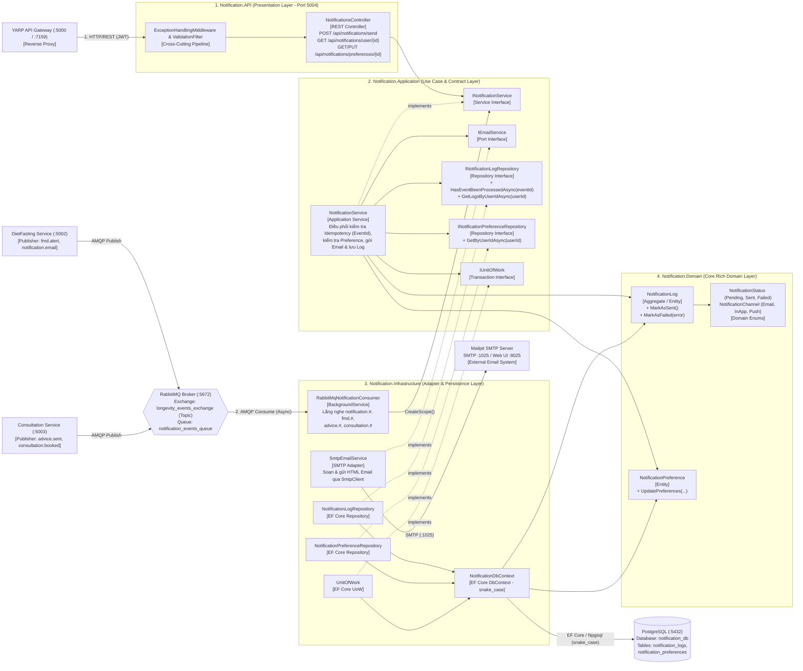
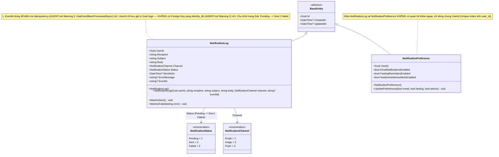
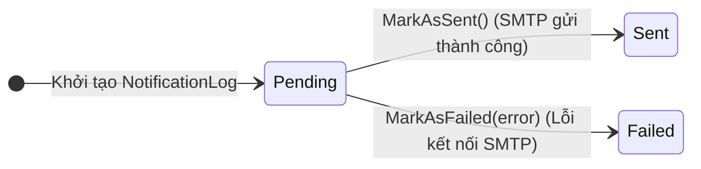
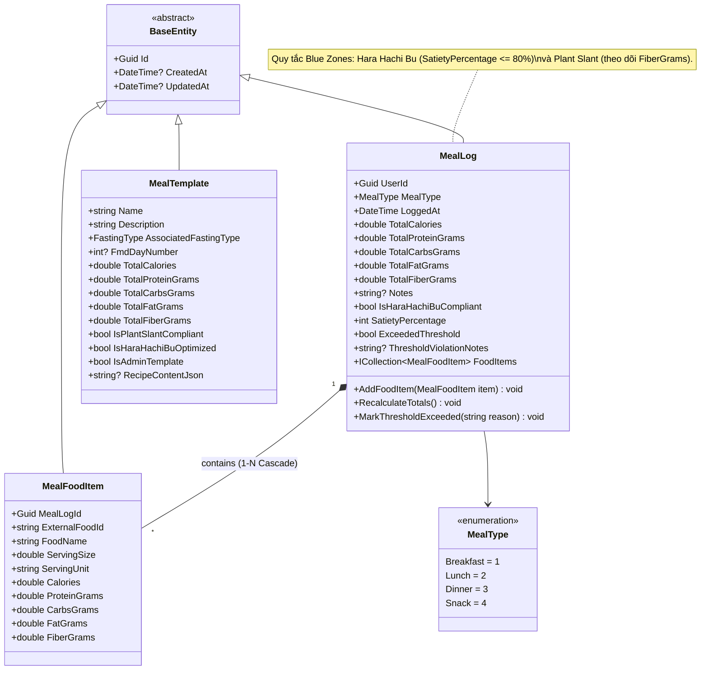
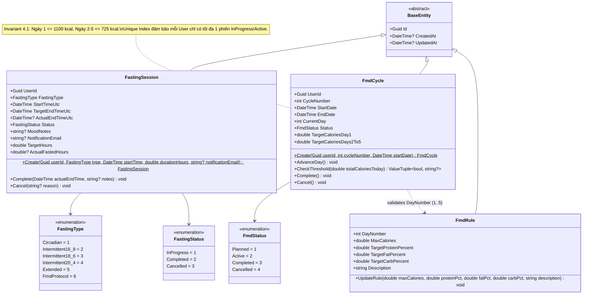

# HƯỚNG DẪN VẼ SƠ ĐỒ KIẾN TRÚC C3 & C4 TOÀN DIỆN DÀNH CHO QUỐC (`C4_DIAGRAM_GUIDE.md`)
## DỰ ÁN: LONGEVITY DIET TRACKER SYSTEM (PRN232)

> **Người thực hiện**: Trần Phạm Khánh Quốc  
> **Mục tiêu**: Hoàn thiện bộ 3 sơ đồ kiến trúc (**C3 Notification**, **C4 Notification**, **C4 DietFasting**) chuẩn 100% theo mã nguồn thực tế, đúng quy tắc Onion Architecture & Rich Domain Model trong `AGENT.md` và `PLAN_ASSIGNMENT.md` (Mục 9).  
> **Nơi lưu trữ file nộp**: `Longevity_Diet_Tracker_System/docs/diagrams/`

---

## 1. HIỂU ĐÚNG VỀ MÔ HÌNH C4 (C1 $\rightarrow$ C2 $\rightarrow$ C3 $\rightarrow$ C4)

Mô hình **C4 Model** (của Simon Brown) giống như việc bạn dùng **Google Maps để phóng to (zoom-in)** dần vào hệ thống phần mềm theo 4 cấp độ:

| Cấp độ | Tên gọi | Phóng to vào đâu? | Câu hỏi cốt lõi mà sơ đồ trả lời | Ai phụ trách? |
| :---: | :--- | :--- | :--- | :---: |
| **C1** | **System Context** | Toàn bộ hệ thống (như 1 hộp đen) + Người dùng (`User`, `Nutritionist`, `Admin`) + Hệ thống ngoài (`Google Auth`, `USDA API`, `Mailpit`) | *"Hệ thống này làm gì, ai sử dụng nó và nó nói chuyện với hệ thống bên ngoài nào?"* | Khoa & Kiệt *(Đã xong)* |
| **C2** | **Container Diagram** | Bên trong hệ thống gồm các khối chạy độc lập: `Web App`, `YARP Gateway`, 5 Microservices, 5 DB PostgreSQL, `Redis`, `RabbitMQ` | *"Hệ thống gồm những dịch vụ/database nào, chạy ở cổng nào và giao tiếp bằng giao thức gì (REST, gRPC, AMQP, SMTP)?"* | Khoa & Kiệt *(Đã xong)* |
| **C3** | **Component Diagram** | **Phóng to vào bên trong 1 Microservice** (chia theo 4 tầng Onion: `API`, `Application`, `Infrastructure`, `Domain`) | *"Bên trong 1 service gồm các Controller, Service, Repository, Consumer nào? Luồng dữ liệu đi qua các tầng ra sao?"* | **Quốc** (`Notification`)<br>Khôi (`Consultation`, `DietFasting`) |
| **C4** | **Code / Class Diagram** | **Phóng to vào tầng `Domain` trong code** (vẽ sơ đồ lớp **UML Class Diagram** cho các Entities & Enums) | *"Các class trong `Domain` có thuộc tính gì, hàm nghiệp vụ (Rich Domain Method) nào, và liên kết với nhau ra sao?"* | **Quốc** (`Notification`, `DietFasting`)<br>Khôi (`Consultation`) |

👉 **Tóm lại nhiệm vụ của Quốc gồm đúng 3 sơ đồ**:
1. **`C3_Notification`**: Sơ đồ Component 4 tầng Onion của `Notification Service`.
2. **`C4_Notification`**: Sơ đồ UML Class Diagram các Entity trong `Notification.Domain`.
3. **`C4_DietFasting`**: Sơ đồ UML Class Diagram các Entity trong `DietFasting.Domain`.

---

## 2. GỢI Ý TOP 4 CÔNG CỤ VẼ C3 & C4 TỐT NHẤT (VÀ CÁCH DÙNG NHANH NHẤT)

Bạn **không cần phải ngồi kẻ từng ô bằng tay từ đầu**, vì toàn bộ mã nguồn sơ đồ chuẩn 100% đã được viết sẵn cho bạn trong thư mục `docs/diagrams/` và ngay tại Mục 4 của file này! Dưới đây là 4 công cụ tốt nhất để bạn xuất ra hình ảnh `.png` sắc nét dán vào Slide:

### 🥇 Công cụ 1: Mermaid Live Editor (`https://mermaid.live`) — **[KHUYÊN DÙNG SỐ 1 - NHANH NHẤT]**
* **Ưu điểm**:
  - Miễn phí 100%, chạy ngay trên trình duyệt, không cần đăng nhập hay cài đặt.
  - Tự động căn chỉnh bố cục UML Class Diagram (C4) và Flowchart (C3) cực kỳ chuẩn chỉnh.
  - Chỉ mất **10 giây** copy code Mermaid từ Mục 4 bên dưới dán vào là có ngay hình ảnh chất lượng cao.
* **Cách sử dụng từng bước**:
  1. Mở trình duyệt truy cập: **`https://mermaid.live`**
  2. Xóa đoạn code mẫu ở khung **Code** bên trái.
  3. Copy khối code `mermaid` của từng hình ở **Mục 4** bên dưới (hoặc mở các file `.mmd` trong `Longevity_Diet_Tracker_System/docs/diagrams/`) dán vào khung **Code**.
  4. Ở khung bên phải, sơ đồ sẽ hiện ra ngay lập tức.
  5. Bấm vào mục **Actions** (góc dưới bên trái hoặc góc phải) $\rightarrow$ Nhập `Width = 2400` (để ảnh siêu nét $\ge$ 1600px) $\rightarrow$ Bấm nút **PNG** hoặc **SVG** để tải hình về máy!

---

### 🥈 Công cụ 2: Draw.io / Diagrams.net (`https://app.diagrams.net`) — **[TỐT NHẤT NẾU MUỐN KÉO THẢ & TÔ MÀU TÙY Ý]**
* **Ưu điểm**:
  - Công cụ vẽ sơ đồ kiến trúc phổ biến nhất thế giới, cho phép bạn tự tay kéo thả vị trí từng hộp, đổi màu nền từng tầng Onion, phóng to chữ tùy thích.
  - **Mẹo "ăn tiền" ít người biết**: Draw.io hỗ trợ **nhập trực tiếp code Mermaid để tự sinh ra các hộp kéo thả được**!
* **Cách biến code Mermaid thành hình kéo thả trong Draw.io (chỉ mất 30 giây)**:
  1. Mở **`https://app.diagrams.net`** $\rightarrow$ Chọn **Create New Diagram** $\rightarrow$ **Blank Diagram**.
  2. Trên thanh menu trên cùng, chọn: **Arrange $\rightarrow$ Insert $\rightarrow$ Advanced $\rightarrow$ Mermaid...** (Hoặc bấm dấu `+` trên thanh công cụ $\rightarrow$ **Advanced $\rightarrow$ Mermaid**).
  3. Dán đoạn code Mermaid ở **Mục 4** vào cửa sổ hiện ra $\rightarrow$ Bấm **Insert**.
  4. Ngay lập tức Draw.io tạo ra toàn bộ sơ đồ với các hộp rời nhau! Lúc này bạn có thể click vào từng hộp để đổi màu, kéo giãn khoảng cách cho đẹp.
  5. Xuất file ảnh chất lượng cao: Chọn **File $\rightarrow$ Export as $\rightarrow$ PNG...** $\rightarrow$ Đặt **Zoom = `200%` hoặc `300%`** $\rightarrow$ Bấm **Export** để tải file `.png` siêu nét. Đồng thời chọn **File $\rightarrow$ Save as** để lưu file `.drawio`.

---

### 🥉 Công cụ 3: Xem & Chụp trực tiếp ngay trong Visual Studio Code (VS Code)
* **Cách dùng**:
  1. Mở chính file **`C4_DIAGRAM_GUIDE.md`** này trong VS Code.
  2. Bấm tổ hợp phím **`Ctrl + Shift + V`** (Mở Markdown Preview).
  3. Nếu VS Code của bạn đã cài extension **`Markdown Preview Mermaid Support`** (ID: `bierner.markdown-mermaid`), cả 4 sơ đồ ở Mục 4 bên dưới sẽ hiển thị thành hình ảnh đồ họa ngay lập tức trong VS Code!

---

### 🏅 Công cụ 4: Structurizr Lite / PlantUML / Lucidchart (Tham khảo thêm)
* **PlantUML (`https://www.planttext.com`)**: Chuyên vẽ UML Class Diagram cổ điển bằng code text.
* **Structurizr (`https://structurizr.com`)**: Công cụ chính chủ của tác giả C4 Model (Simon Brown), mạnh cho C1–C3 nhưng ít hỗ trợ C4 Class Diagram chi tiết bằng Mermaid/Draw.io.
* **Lucidchart (`https://www.lucidchart.com`)**: Giao diện đẹp nhưng bản miễn phí giới hạn số lượng khối (60 shapes/diagram), nên dễ bị khóa khi vẽ sơ đồ lớn như `DietFasting`.

👉 **KẾT LUẬN CHỌN CÔNG CỤ CHO QUỐC**: Dùng **`https://mermaid.live`** (để xuất PNG trong 10 giây) kết hợp **`https://app.diagrams.net`** (nếu muốn tô màu thêm cho các khung).

---

## 3. QUY TẮC BẮT BUỘC KHI VẼ C3 & C4 (ĐỂ THẦY KHÔNG BẮT BẺ ĐƯỢC)

### 3.1. Quy tắc vẽ C4 (UML Class Diagram cho tầng `Domain`)
Khi vẽ C4, thực chất là vẽ **UML Class Diagram** cho các class trong project `{Service}.Domain`. Phải tuân thủ 5 quy tắc sau:

1. **Cấu trúc 3 ngăn của 1 hộp Class**:
   ```text
   ┌────────────────────────────────────────────────────────────┐
   │                      NotificationLog                       │  <-- Ngăn 1: Tên Entity Class
   ├────────────────────────────────────────────────────────────┤
   │ + Guid UserId                                              │  <-- Ngăn 2: Các thuộc tính (Properties)
   │ + string Recipient                                         │      Dấu '+' nghĩa là public
   │ + NotificationStatus Status                                │
   │ + string? EventId                                          │
   ├────────────────────────────────────────────────────────────┤
   │ + MarkAsSent() : void                                      │  <-- Ngăn 3: Các hàm nghiệp vụ (Methods)
   │ + MarkAsFailed(string error) : void                        │      Chứng minh Rich Domain Model!
   └────────────────────────────────────────────────────────────┘
   ```
2. **Tại sao Ngăn 3 (Method nghiệp vụ) lại sống còn?**
   - Theo `AGENT.md` Mục 2.1: Hệ thống bắt buộc áp dụng **Rich Domain Model** (mọi logic kiểm tra hợp lệ và đổi trạng thái phải nằm trong hàm của chính Entity như `MarkAsSent()`, `AdvanceDay()`, `CheckThreshold()`, `MarkThresholdExceeded()`, chứ không phải class rỗng chỉ có `get; set;`).
3. **4 Loại mũi tên quan hệ chuẩn UML cần phân biệt rõ**:
   - `BaseEntity <|-- NotificationLog` (**Mũi tên tam giác rỗng - Inheritance/Kế thừa**): `NotificationLog` kế thừa `Id`, `CreatedAt`, `UpdatedAt` từ lớp cha `BaseEntity`.
   - `MealLog "1" *-- "*" MealFoodItem` (**Hình thoi đặc - Composition/Thành phần**): Một bữa ăn (`MealLog`) chứa nhiều món ăn (`MealFoodItem`). Nếu xóa `MealLog` thì các `MealFoodItem` bên trong cũng bị xóa theo (`Cascade Delete`).
   - `NotificationLog --> NotificationStatus` (**Mũi tên thường - Association/Sử dụng**): Class sử dụng kiểu dữ liệu Enum.
   - `MealLog ..> FmdCycle` (**Mũi tên nét đứt - Dependency/Phụ thuộc nghiệp vụ**): Khi ghi nhận bữa ăn trong chu kỳ FMD, `MealLog` kiểm tra ngưỡng calo của `FmdCycle` (`CheckThreshold()` $\rightarrow$ `MarkThresholdExceeded()`).
4. **Quy tắc Database-per-Service (`AGENT.md` Warning 2)**:
   - Tuyệt đối **KHÔNG** vẽ đường nối khóa ngoại (Foreign Key) từ `UserId` sang bảng `User` của `Identity Service`.
   - Bắt buộc đặt một hộp **Ghi chú (`Note`)** trên hình: *"UserId chỉ lưu Guid tham chiếu logic — KHÔNG có Foreign Key xuyên database (tuân thủ Database-per-Service)"*.
5. **Điểm cộng lớn**: Vẽ kèm sơ đồ chuyển trạng thái (`State Machine`) nhỏ cho cột `Status` (ví dụ: `Pending --> Sent` hoặc `Pending --> Failed`).

---

### 3.2. Quy tắc vẽ C3 (Component Diagram cho 4 tầng Onion)
1. **Chia đúng 4 khung (`subgraph`) theo 4 tầng Onion Architecture (`AGENT.md` Mục 2)**:
   - Khung 1: `Notification.API` (Presentation Layer — chứa `NotificationsController`, Middleware).
   - Khung 2: `Notification.Application` (Use Case Layer — chứa `INotificationService`, `NotificationService`, `IEmailService`, `INotificationLogRepository`, `INotificationPreferenceRepository`, `IUnitOfWork`).
   - Khung 3: `Notification.Infrastructure` (Adapter Layer — chứa `RabbitMqNotificationConsumer`, `SmtpEmailService`, `NotificationLogRepository`, `NotificationPreferenceRepository`, `NotificationDbContext`).
   - Khung 4: `Notification.Domain` (Core Layer — chứa `NotificationLog`, `NotificationPreference`, Enums).
2. **Chiều mũi tên phụ thuộc (Dependency Rule - `AGENT.md` Warning 1)**:
   - Mũi tên chỉ được đi **từ ngoài vào trong** (`API` $\rightarrow$ `Application` $\rightarrow$ `Domain`, và `Infrastructure` `.->` `implements` các Interface của `Application` & gọi `Domain`).
   - **Tuyệt đối không được** vẽ bất kỳ mũi tên nào xuất phát từ `Domain` chỉ ngược ra `Infrastructure` hay `API`!
3. **Vẽ đầy đủ các hệ thống bên ngoài ở rìa sơ đồ kèm nhãn giao thức**:
   - Bên trái (Đầu vào): `YARP API Gateway` đi vào bằng `HTTP/REST (JWT)` và `RabbitMQ Broker` đi vào `RabbitMqNotificationConsumer` bằng `AMQP (Async Queue: notification_events_queue)`.
   - Bên phải (Đầu ra): `SmtpEmailService` bắn ra `Mailpit SMTP (:1025)` bằng giao thức `SMTP` và `NotificationDbContext` lưu xuống `PostgreSQL (notification_db)` bằng `EF Core / Npgsql (snake_case)`.

---

## 4. TRỌN BỘ CODE & HÌNH VẼ CHI TIẾT 3 SƠ ĐỒ CỦA QUỐC (SẴN SÀNG COPY & XUẤT PNG)

---

### HÌNH 1: `[C3] Component Diagram – Notification Service`
* **File lưu trong repo**: [C3_Notification.mmd](file:///d:/Documents/PRN222/PRN232_LongevityDietTracker/Longevity_Diet_Tracker_System/docs/diagrams/C3_Notification.mmd)
* **Điểm nhấn bắt buộc trên hình**:
  1. Thể hiện rõ **2 luồng đi vào**: Luồng đồng bộ `HTTP/REST` qua `NotificationsController` và luồng bất đồng bộ `AMQP` từ `RabbitMQ` qua `RabbitMqNotificationConsumer` (`BackgroundService`).
  2. Thể hiện rõ hàm `HasEventBeenProcessedAsync(eventId)` tại `INotificationLogRepository` để đảm bảo **Idempotency** (chống gửi trùng email — `AGENT.md` Warning 5).



---

### HÌNH 2: `[C4] Code / Class Diagram – Notification.Domain`
* **File lưu trong repo**: [C4_Notification.mmd](file:///d:/Documents/PRN222/PRN232_LongevityDietTracker/Longevity_Diet_Tracker_System/docs/diagrams/C4_Notification.mmd)
* **Bảng đối chiếu chính xác với source code (`NotificationEntities.cs` & `NotificationEnums.cs`)**:

| Tên Class / Enum | Loại | Thuộc tính (`Properties`) | Method nghiệp vụ (`Rich Domain Methods`) |
| :--- | :---: | :--- | :--- |
| `BaseEntity` | `abstract class` | `Id (Guid)`, `CreatedAt (DateTime?)`, `UpdatedAt (DateTime?)` | — |
| `NotificationLog` | `Entity` (kế thừa `BaseEntity`) | `UserId (Guid)`, `Recipient (string)`, `Subject (string)`, `Body (string)`, `Channel (NotificationChannel)`, `Status (NotificationStatus)`, `SentAtUtc (DateTime?)`, `ErrorMessage (string?)`, **`EventId (string?)`** | `+MarkAsSent() : void`<br>`+MarkAsFailed(string error) : void` |
| `NotificationPreference` | `Entity` (kế thừa `BaseEntity`) | `UserId (Guid)`, `EmailNotificationsEnabled (bool)`, `FastingRemindersEnabled (bool)`, `NutritionistAdviceAlertsEnabled (bool)` | `+UpdatePreferences(bool email, bool fasting, bool advice) : void` |
| `NotificationStatus` | `enum` | `Pending = 1`, `Sent = 2`, `Failed = 3` | — |
| `NotificationChannel` | `enum` | `Email = 1`, `InApp = 2`, `Push = 3` | — |



* **Sơ đồ chuyển trạng thái nhỏ (State Diagram đi kèm cho `NotificationLog.Status` — Điểm cộng khi đưa vào Slide)**:


---

### HÌNH 3: `[C4] Code / Class Diagram – DietFasting.Domain`
* **File lưu trong repo**: [C4_DietFasting.mmd](file:///d:/Documents/PRN222/PRN232_LongevityDietTracker/Longevity_Diet_Tracker_System/docs/diagrams/C4_DietFasting.mmd)
* **Bảng đối chiếu chính xác với source code (`DietEntities.cs` & `DietEnums.cs`)**:

| Tên Class / Enum | Loại | Thuộc tính chính (`Properties`) | Method nghiệp vụ (`Rich Domain Methods`) |
| :--- | :---: | :--- | :--- |
| `MealLog` | `Entity` | `UserId`, `MealType`, `LoggedAt`, `TotalCalories`, `TotalProteinGrams`, `TotalCarbsGrams`, `TotalFatGrams`, `TotalFiberGrams`, `Notes`, `IsHaraHachiBuCompliant`, `SatietyPercentage`, **`ExceededThreshold`**, **`ThresholdViolationNotes`**, `FoodItems` | `+AddFoodItem(MealFoodItem)`<br>`+RecalculateTotals()`<br>**`+MarkThresholdExceeded(string reason)`** |
| `MealFoodItem` | `Entity` | `MealLogId`, `ExternalFoodId`, `FoodName`, `ServingSize`, `ServingUnit`, `Calories`, `ProteinGrams`, `CarbsGrams`, `FatGrams`, `FiberGrams` | — (`MealLog 1 *-- * MealFoodItem`) |
| `FastingSession` | `Entity` | `UserId`, `FastingType`, `StartTimeUtc`, `TargetEndTimeUtc`, `ActualEndTimeUtc?`, `Status`, `MoodNotes?`, `NotificationEmail?`, `TargetHours`, `ActualFastedHours?` | `+Create(...)` *(static)*<br>`+Complete(DateTime, string?)`<br>`+Cancel(string?)` |
| `FmdCycle` | `Entity` | `UserId`, `CycleNumber`, `StartDate`, `EndDate`, `CurrentDay`, `Status`, `TargetCaloriesDay1 = 1100`, `TargetCaloriesDays2To5 = 725` | `+Create(...)` *(static)*<br>`+AdvanceDay()`<br>**`+CheckThreshold(double)`**<br>`+Complete()` / `+Cancel()` |
| `FmdRule` | `Entity` | `DayNumber (1..5)`, `MaxCalories`, `TargetProteinPercent`, `TargetFatPercent`, `TargetCarbPercent`, `Description` | `+UpdateRule(...)` |
| `MealTemplate` | `Entity` | `Name`, `Description`, `AssociatedFastingType`, `FmdDayNumber?`, `TotalCalories`, `TotalProtein/Carbs/Fat/FiberGrams`, `IsPlantSlantCompliant`, `IsHaraHachiBuOptimized`, `IsAdminTemplate`, `RecipeContentJson?` | — |

#### Bản 3.1: Sơ đồ C4 Tổng hợp toàn bộ `DietFasting.Domain` (1 hình đầy đủ)

```mermaid
classDiagram
    class BaseEntity {
        <<abstract>>
        +Guid Id
        +DateTime? CreatedAt
        +DateTime? UpdatedAt
    }

    class MealLog {
        +Guid UserId
        +MealType MealType
        +DateTime LoggedAt
        +double TotalCalories
        +double TotalProteinGrams
        +double TotalCarbsGrams
        +double TotalFatGrams
        +double TotalFiberGrams
        +string? Notes
        +bool IsHaraHachiBuCompliant
        +int SatietyPercentage
        +bool ExceededThreshold
        +string? ThresholdViolationNotes
        +ICollection~MealFoodItem~ FoodItems
        +AddFoodItem(MealFoodItem item) void
        +RecalculateTotals() void
        +MarkThresholdExceeded(string reason) void
    }

    class MealFoodItem {
        +Guid MealLogId
        +string ExternalFoodId
        +string FoodName
        +double ServingSize
        +string ServingUnit
        +double Calories
        +double ProteinGrams
        +double CarbsGrams
        +double FatGrams
        +double FiberGrams
    }

    class FastingSession {
        +Guid UserId
        +FastingType FastingType
        +DateTime StartTimeUtc
        +DateTime TargetEndTimeUtc
        +DateTime? ActualEndTimeUtc
        +FastingStatus Status
        +string? MoodNotes
        +string? NotificationEmail
        +double TargetHours
        +double? ActualFastedHours
        +Create(Guid userId, FastingType type, DateTime startTime, double durationHours, string? notificationEmail)$ FastingSession
        +Complete(DateTime actualEndTime, string? notes) void
        +Cancel(string? reason) void
    }

    class FmdCycle {
        +Guid UserId
        +int CycleNumber
        +DateTime StartDate
        +DateTime EndDate
        +int CurrentDay
        +FmdStatus Status
        +double TargetCaloriesDay1
        +double TargetCaloriesDays2To5
        +Create(Guid userId, int cycleNumber, DateTime startDate)$ FmdCycle
        +AdvanceDay() void
        +CheckThreshold(double totalCaloriesToday) ValueTuple~bool, string?~
        +Complete() void
        +Cancel() void
    }

    class FmdRule {
        +int DayNumber
        +double MaxCalories
        +double TargetProteinPercent
        +double TargetFatPercent
        +double TargetCarbPercent
        +string Description
        +UpdateRule(double maxCalories, double proteinPct, double fatPct, double carbPct, string description) void
    }

    class MealTemplate {
        +string Name
        +string Description
        +FastingType AssociatedFastingType
        +int? FmdDayNumber
        +double TotalCalories
        +double TotalProteinGrams
        +double TotalCarbsGrams
        +double TotalFatGrams
        +double TotalFiberGrams
        +bool IsPlantSlantCompliant
        +bool IsHaraHachiBuOptimized
        +bool IsAdminTemplate
        +string? RecipeContentJson
    }

    class MealType {
        <<enumeration>>
        Breakfast = 1
        Lunch = 2
        Dinner = 3
        Snack = 4
    }

    class FastingType {
        <<enumeration>>
        Circadian = 1
        Intermittent16_8 = 2
        Intermittent18_6 = 3
        Intermittent20_4 = 4
        Extended = 5
        FmdProtocol = 6
    }

    class FastingStatus {
        <<enumeration>>
        InProgress = 1
        Completed = 2
        Cancelled = 3
    }

    class FmdStatus {
        <<enumeration>>
        Planned = 1
        Active = 2
        Completed = 3
        Cancelled = 4
    }

    BaseEntity <|-- MealLog
    BaseEntity <|-- MealFoodItem
    BaseEntity <|-- FastingSession
    BaseEntity <|-- FmdCycle
    BaseEntity <|-- FmdRule
    BaseEntity <|-- MealTemplate

    MealLog "1" *-- "*" MealFoodItem : contains (Cascade)
    MealLog --> MealType
    FastingSession --> FastingType
    FastingSession --> FastingStatus
    FmdCycle --> FmdStatus
    MealTemplate --> FastingType
    FmdCycle ..> FmdRule : validates DayNumber (1..5)
    MealLog ..> FmdCycle : CheckThreshold() -> MarkThresholdExceeded()

    note for FmdCycle "Invariant 4.1: Ngày 1 <= 1100 kcal, Ngày 2-5 <= 725 kcal.\nKhi vượt ngưỡng, MealLog.MarkThresholdExceeded() bật cờ ExceededThreshold = true và bắn FmdCycleAlertIntegrationEvent.\nUserId tham chiếu logic sang identity_db (KHÔNG có Foreign Key)."
```



---

#### Bản 3.2 (Mẹo trình chiếu Slide): Tách `C4_DietFasting` thành 2 nửa để chữ cực to khi chiếu Slide
Theo mục 9.3.F của `PLAN_ASSIGNMENT.md`: *"Nếu hình quá dài, được phép tách làm 2 hình: (1) Meals + Templates, (2) Fasting + FMD"* để khi dán vào slide PowerPoint chữ to rõ, ngồi cuối lớp vẫn đọc được:

**Nửa A: `C4_DietFasting` — Nhóm Bữa Ăn & Thực Đơn Mẫu Blue Zones (`MealLog`, `MealFoodItem`, `MealTemplate`)**:


**Nửa B: `C4_DietFasting` — Nhóm Nhịn Ăn Gián Đoạn & Chu Kỳ FMD 5 Ngày (`FastingSession`, `FmdCycle`, `FmdRule`)**:


---

## 5. BỘ CÂU HỎI & CÂU TRẢ LỜI MẪU KHI GIẢNG VIÊN HỎI VẤN ĐÁP QUỐC VỀ C3 & C4

Khi đứng lên trình bày hoặc khi thầy chỉ vào sơ đồ C3 / C4 của Quốc và hỏi, hãy trả lời tự tin theo 5 kịch bản dưới đây:

1. **Câu hỏi 1**: *"Em hãy giải thích sơ đồ C3 của Notification Service?"*
   - **Trả lời**: *"Thưa thầy, `Notification Service` được thiết kế theo chuẩn **Onion Architecture 4 tầng**. Có **2 luồng đi vào**: Luồng thứ nhất là đồng bộ qua HTTP từ `YARP Gateway` vào `NotificationsController`. Luồng thứ hai là bất đồng bộ Event-Driven từ `RabbitMQ` (`notification_events_queue`) đi vào `RabbitMqNotificationConsumer` (chạy ngầm dưới dạng `BackgroundService`). Cả hai luồng đều gọi vào `NotificationService` ở tầng `Application`, kiểm tra chống trùng lặp (`Idempotency`) qua `INotificationLogRepository.HasEventBeenProcessedAsync(EventId)`, sau đó gửi email HTML qua `SmtpEmailService` tới `Mailpit` (cổng `1025`) và lưu lịch sử vào `notification_db`. Đặc biệt, tầng `Domain` nằm ở lõi trong cùng và hoàn toàn không phụ thuộc vào bất kỳ thư viện hạ tầng nào."*

2. **Câu hỏi 2**: *"Trong sơ đồ C4, tại sao các class như `NotificationLog`, `FmdCycle`, `MealLog` lại có các hàm `MarkAsSent()`, `AdvanceDay()`, `MarkThresholdExceeded()` bên trong Entity mà không viết ở Service hay Controller?"*
   - **Trả lời**: *"Thưa thầy, nhóm em tuân thủ nguyên tắc **Rich Domain Model** thay vì Anemic Domain Model. Mọi quy tắc bất biến (Domain Invariants) và việc chuyển đổi trạng thái (`Pending` $\rightarrow$ `Sent`, hay `CurrentDay` từ 1 $\rightarrow$ 5, hay bật cờ `ExceededThreshold = true`) đều được đóng gói bên trong chính Entity để bảo vệ tính toàn vẹn trạng thái của đối tượng ở mọi nơi."*

3. **Câu hỏi 3**: *"Tại sao trong sơ đồ C4 của em, thuộc tính `UserId` trong `NotificationLog` và `FmdCycle` lại không có đường nối khóa ngoại (Foreign Key) sang bảng `User`?"*
   - **Trả lời**: *"Thưa thầy, vì hệ thống áp dụng mẫu kiến trúc **Database-per-Service** (`notification_db`, `diet_db`, `identity_db` là các database độc lập). Nếu tạo Foreign Key xuyên database sẽ gâyTight Coupling giữa các microservices. Do đó `UserId` chỉ lưu định danh `Guid` logic được trích xuất từ JWT Token hoặc Integration Event."*

4. **Câu hỏi 4**: *"Nếu RabbitMQ gửi lặp lại cùng một sự kiện `FmdCycleAlertIntegrationEvent` hai lần (At-least-once delivery), hệ thống của em xử lý thế nào để người dùng không bị nhận 2 email cảnh báo giống hệt nhau?"*
   - **Trả lời**: *"Thưa thầy, trên class `NotificationLog` (sơ đồ C4) em thiết kế trường `EventId` có đánh Index (`ix_notification_logs_event_id`). Trước khi gửi mail, `NotificationService` luôn gọi `HasEventBeenProcessedAsync(EventId)`. Nếu `EventId` của message RabbitMQ đã tồn tại trong bảng `notification_logs`, hệ thống sẽ bỏ qua ngay lập tức, đảm bảo tính **Idempotency**."*

5. **Câu hỏi 5**: *"Luồng cảnh báo khi người dùng ăn vượt quá 1100 kcal trong ngày 1 của chu kỳ FMD diễn ra giữa các class nào trên sơ đồ C4 `DietFasting`?"*
   - **Trả lời**: *"Thưa thầy, khi người dùng thêm các `MealFoodItem` vào `MealLog`, hàm `MealLog.RecalculateTotals()` tự cộng tổng calo. Nếu người dùng đang có một `FmdCycle` ở trạng thái `Active`, hệ thống đối chiếu tổng calo trong ngày với ngưỡng của `FmdRule` / `FmdCycle` (Ngày 1 là 1100 kcal, Ngày 2–5 là 725 kcal). Khi vượt ngưỡng, hàm `MealLog.MarkThresholdExceeded(reason)` được gọi để bật cờ `ExceededThreshold = true`, đồng thời bắn sự kiện `FmdCycleAlertIntegrationEvent` qua RabbitMQ để `Notification Service` gửi email cảnh báo đỏ về hộp thư của người dùng."*

