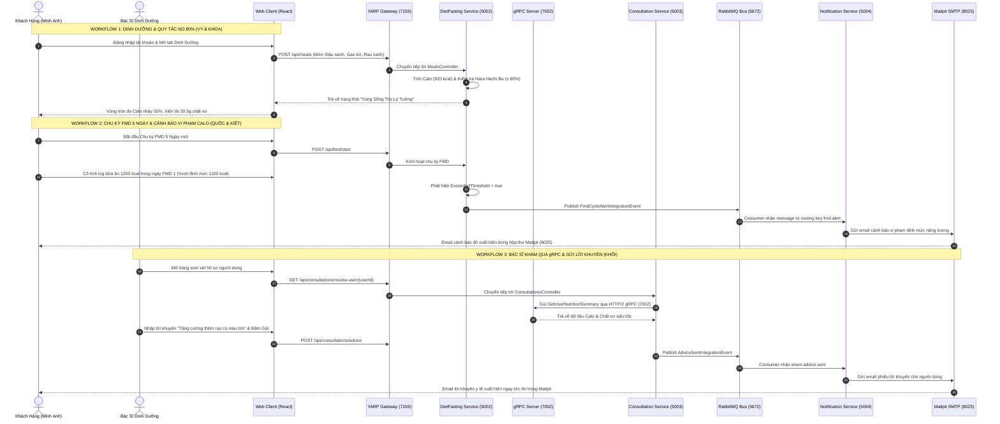
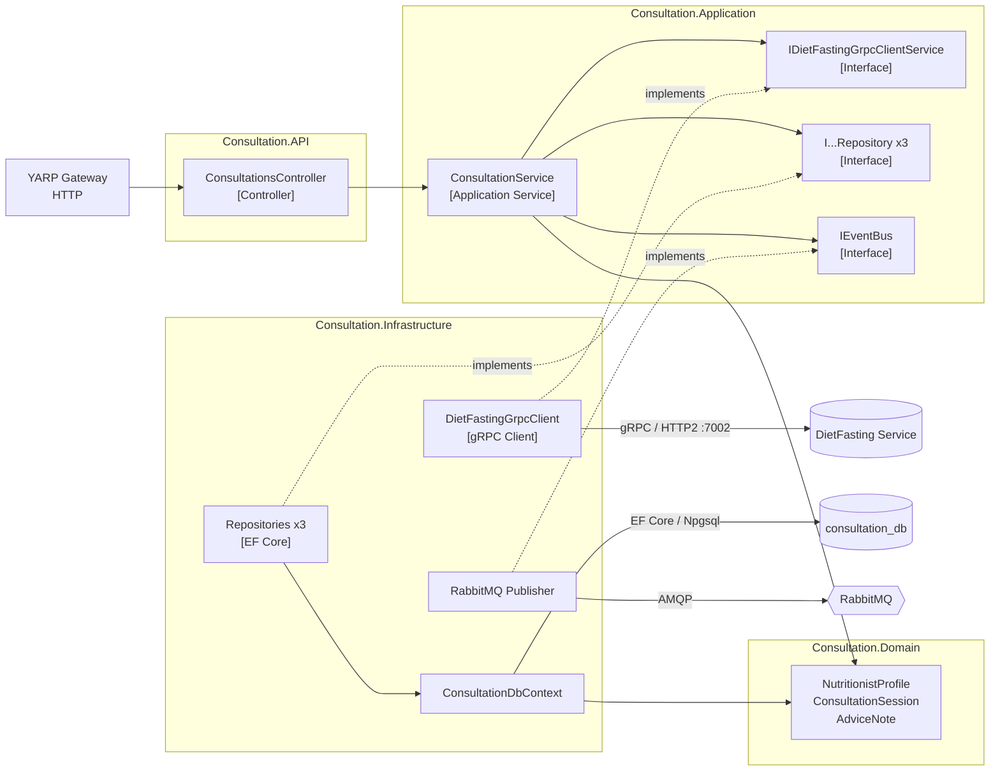
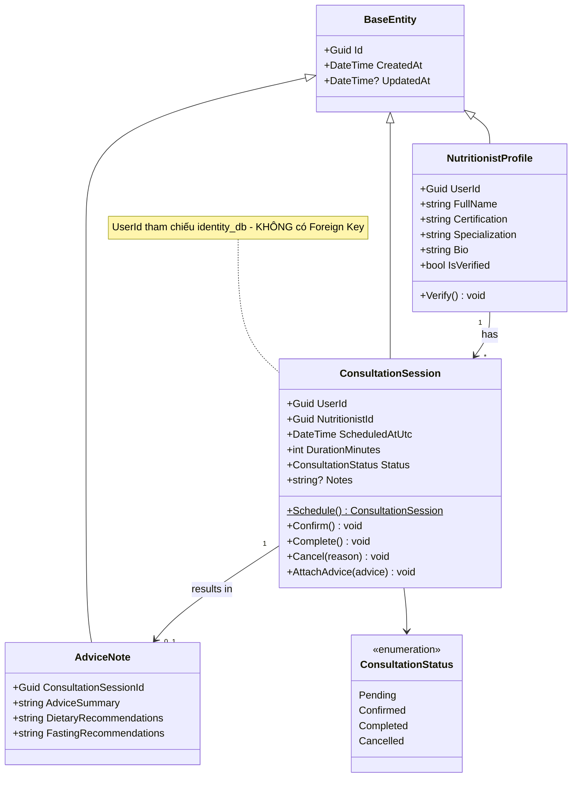

# KẾ HOẠCH HÀNH ĐỘNG & BẢNG PHÂN TÍCH CÂN BẰNG TẢI (MASTER PLAN V4 - DEFINITIVE)
## DỰ ÁN: LONGEVITY DIET TRACKER SYSTEM (PRN232)

> **Mục tiêu**: Báo cáo & Chấm tiến độ với Giảng viên vào **Slot 1 — Sáng Thứ 2 (16/11/2026)**  
> **Căn cứ**: `AGENT.md`, Khung slide 24 trang (`Guideline V1.0`), Quy chuẩn luồng nghiệp vụ (`Workflow là gì - PDF`), C0 Context Diagram & C2 Architecture Diagram.  
> **Cam kết cốt lõi**: Đảm bảo **cân đối 100% về độ khó và khối lượng công việc** cho cả 5 thành viên, bao quát trọn vẹn toàn bộ 30 REST APIs, 3 gRPC Methods, 8 RabbitMQ Integration Events, 4 PostgreSQL Databases, 1 Redis Cache, 1 Hangfire Service và trọn bộ Frontend Web Client.

---

## 1. RÀ SOÁT ĐẦY ĐỦ CÁC DOMAIN & HIỆN TRẠNG TOÀN HỆ THỐNG

Sau khi kiểm toán chi tiết toàn bộ mã nguồn (`ApiGateways`, `BuildingBlocks`, 5 `Services`, các Controller, Entity và Repository), hệ thống bao gồm đầy đủ **5 Domain chuẩn kiến trúc Microservices**:

1. **Domain 1: Core Fasting & Dinh Dưỡng Blue Zones (`Diet & Fasting Service` - Port 5002 / gRPC 7002)**:
   * *Module Bữa ăn & Macros*: `MealsController` (`POST /api/meals`, `GET /api/meals/user/{id}`).
   * *Module Tra cứu Dinh dưỡng*: `NutritionController` (`GET /api/nutrition/search`, `GET /api/nutrition/details/{id}`) tích hợp **Redis Distributed Cache**.
   * *Module Nhịn ăn gián đoạn (IF 16/8 & OMAD)*: `FastingController` (`POST /api/fasting/start`, `POST /api/fasting/{id}/end`, `GET /api/fasting/user/{id}/active`).
   * *Module Chu kỳ FMD 5 ngày*: `FmdController` (`POST /api/fmd/start`, `GET /api/fmd/user/{id}/active`).
   * *Module Quản trị Master Data Admin*: `FmdRulesController` (2 APIs) và `MealTemplatesController` (3 APIs).
   * *Module gRPC Server*: Mở cổng `7002` phản hồi dữ liệu qua HTTP/2 Protobuf (`diet_fasting.proto`).
2. **Domain 2: Tư Vấn Chuyên Gia & Hợp Đồng gRPC Client (`Consultation Service` - Port 5003)**:
   * `ConsultationsController`: Đặt lịch hẹn (`/book`), Bác sĩ kê lời khuyên (`/advice`), Hồ sơ chuyên gia (`/nutritionist/{id}`).
   * **gRPC Client (`DietFastingGrpcClient`)**: Gọi đồng bộ sang cổng 7002 của DietFasting để lấy snapshot dinh dưỡng và lịch sử nhịn ăn phục vụ buổi tư vấn.
3. **Domain 3: Hệ Thống Thông Báo & Event Consumer (`Notification Service` - Port 5004)**:
   * `NotificationsController`: Xem lịch sử thông báo, Gửi thông báo trực tiếp, Cài đặt tùy chọn nhận tin (`/preferences`).
   * **RabbitMQ Consumer (`RabbitMqNotificationConsumer`)**: BackgroundService lắng nghe message từ Queue `notification_events_queue`.
   * **SMTP Mail Client (`SmtpEmailService`)**: Soạn email HTML chuẩn y tế và gửi qua Mailpit (Port 1025 / Web 8025).
4. **Domain 4: Tác Vụ Nền, Hangfire & DevOps (`JobService` - Port 5005 & Docker)**:
   * `JobsController`: Kích hoạt job kiểm tra thủ công (`/jobs/trigger/fasting-check`, `/jobs/trigger/fmd-check`).
   * **Hangfire Schedulers**: Recurring Jobs định kỳ quét phiên nhịn ăn hết giờ và quét chuyển ngày chu kỳ FMD 5 ngày.
   * **RabbitMQ Publisher (`RabbitMqJobPublisher`)**: Bắn trigger event vào Exchange `longevity_events_exchange`.
   * **DevOps/Docker**: 4 container Docker (`postgres`, `redis`, `rabbitmq`, `mailpit`) và script khởi tạo 5 database tự động.
5. **Domain 5: Gateway, Identity & Nền Tảng Chung (`YarpGateway` - Port 5000/7159 & `Identity Service` - Port 5001)**:
   * **YARP Reverse Proxy**: Định tuyến từ cổng `5000` (HTTPS `7159`) tới 4 cụm microservices nội bộ, xử lý CORS toàn hệ thống.
   * **Identity Service**: `AuthController` (Register, Login, Google OAuth, Refresh Token) & `UsersController` (Profile thể trạng & mục tiêu sức khỏe).

---

## 2. BẢNG ĐÁNH GIÁ CÂN BẰNG TẢI (WORKLOAD BALANCE SCORE) CHO 5 THÀNH VIÊN

Để không có bất kỳ sự chênh lệch nào (người quá nặng, người quá nhẹ), khối lượng công việc được phân bổ theo bảng định lượng dưới đây:

| Thành viên | Phân hệ Backend đảm nhiệm | Màn hình Frontend (Web App) | "Vũ khí" Kỹ thuật chuyên sâu | Điểm tải |
| :--- | :--- | :--- | :--- | :---: |
| **Hoàng Lê Khoa** *(Leader)* | - `Identity Service` (6 REST APIs)<br>- `YarpGateway` (Reverse Proxy 10 routes)<br>- Cấu hình Docker & Script Multi-DB | Màn hình **Đăng ký, Đăng nhập & Profile cá nhân** (`features/auth/`) | **YARP Proxy & Google OAuth 2.0 / JWT Multi-role** | **8.5 / 10** |
| **Nguyễn Ngọc Tường Vy** | - `DietFasting (Meal Module)` (2 REST APIs)<br>- `Nutrition Module` (2 REST APIs)<br>- `MealTemplates (Thực đơn mẫu)` (3 REST APIs)<br>- Thuật toán tính vi/đa lượng (Macros)<br>- Quy tắc ăn no 80% (Hara Hachi Bu) | - Màn hình **Nhật ký Bữa ăn & Tra cứu món ăn** (`features/meals/`)<br>- **Dựng khung Web App chung** (Sidebar, Navbar, Theme Luxury)<br>- **Landing Page công khai & Dashboard 4 trụ cột** | **External Nutrition API (USDA), Redis Distributed Cache & Blue Zones Meal Templates** | **8.5 / 10** |
| **Trần Anh Kiệt** | - `DietFasting (Fasting Module)` (3 REST APIs)<br>- `JobService (Hangfire)` (2 APIs)<br>- **Triển khai gRPC Server (Cổng 7002, 3 RPCs)**<br>- Hangfire Recurring Schedulers | Màn hình **Đồng hồ bấm giờ Nhịn ăn 16/8 & OMAD** (`features/fasting/`) | **gRPC Server (HTTP/2 Protobuf) & Hangfire Background Schedulers** | **8.5 / 10** |
| **Trần Phạm Khánh Quốc** | - `DietFasting (FMD Module)` (2 REST APIs)<br>- `Admin FMD Rules` (2 REST APIs)<br>- `Notification Service` (4 REST APIs)<br>- Logic cảnh báo vi phạm calo FMD | Màn hình **Lộ trình Chu kỳ FMD 5 ngày & Hộp thư thông báo** (`features/fmd/`) | **RabbitMQ Consumer (Async Event-Driven) & SMTP Mailpit Client** | **8.5 / 10** |
| **Dương Đình Khôi** | - `Consultation Service` (4 REST APIs)<br>- Nghiệp vụ Bác sĩ dinh dưỡng & Đặt lịch khám<br>- Quản lý Phiếu lời khuyên (`AdviceNote`)<br>- **Tích hợp gRPC Client sang cổng 7002** | Màn hình **Đặt lịch tư vấn & Bác sĩ gửi phiếu lời khuyên** (`features/consultation/`) | **gRPC Client (Inter-service Sync) & RabbitMQ Event Publisher** | **8.5 / 10** |

👉 **NHẬN XÉT ĐỘ CÂN ĐỐI**:  
* Mức độ cân đối: **Đều chằn chặn 8.5/10 cho cả 5 thành viên**!
* Không ai bị quá tải (Vy không phải gánh một mình cả Fasting lẫn FMD và gRPC).
* Quốc và Kiệt đều có phần Backend cốt lõi thuộc `DietFasting` kèm theo 1 dịch vụ chuyên sâu (Kiệt có gRPC Server + Hangfire, Quốc có FMD + RabbitMQ Consumer + Mailpit).
* Mỗi người đều sở hữu đúng **1 kỹ thuật cao cấp đặc trưng** để tự tin trả lời vấn đáp khi giảng viên chấm điểm từng cá nhân!

---

## 3. BẢNG ĐẶC TẢ CHI TIẾT 100% TOÀN BỘ 30 APIS & 3 gRPC METHODS HIỆN HỮU

Dưới đây là danh mục chính xác đến từng endpoint, method, route gateway và payload đã có sẵn trong mã nguồn backend:

### BẢNG 1: IDENTITY & USER PROFILE (KHOA PHỤ TRÁCH) — PORT 5001
| Method | Endpoint qua Gateway (`https://localhost:7159`) | Target Service Route | Request Body / Query Params | Chức năng & Kết quả nghiệp vụ |
| :---: | :--- | :--- | :--- | :--- |
| `POST` | `/api/auth/register` | `Identity.API: /api/auth/register` | `RegisterRequestDto` (`Email`, `Password`, `FullName`, `Role`) | Đăng ký tài khoản mới (User / Nutritionist / Admin). |
| `POST` | `/api/auth/login` | `Identity.API: /api/auth/login` | `LoginRequestDto` (`Email`, `Password`) | Đăng nhập bằng Email & Mật khẩu, sinh JWT Token & Refresh Token. |
| `POST` | `/api/auth/google-login` | `Identity.API: /api/auth/google-login` | `GoogleLoginRequestDto` (`IdToken`) | Đăng nhập một chạm Google OAuth 2.0. |
| `POST` | `/api/auth/refresh-token` | `Identity.API: /api/auth/refresh-token` | `RefreshTokenRequestDto` (`Token`, `RefreshToken`) | Gia hạn phiên làm việc JWT an toàn. |
| `GET` | `/api/users/{id}/profile` | `Identity.API: /api/users/{id}/profile` | Route param: `id` (GUID) | Lấy hồ sơ thể trạng người dùng (Chiều cao, cân nặng, mục tiêu). |
| `PUT` | `/api/users/{id}/profile` | `Identity.API: /api/users/{id}/profile` | `UserProfileDto` | Cập nhật hồ sơ thể trạng và sở thích ăn uống. |

---

### BẢNG 2: BỮA ĂN, TRA CỨU DINH DƯỠNG & THỰC ĐƠN MẪU BLUE ZONES (VY PHỤ TRÁCH) — PORT 5002
| Method | Endpoint qua Gateway (`https://localhost:7159`) | Target Service Route | Request Body / Query Params | Chức năng & Kết quả nghiệp vụ |
| :---: | :--- | :--- | :--- | :--- |
| `POST` | `/api/meals` | `DietFasting.API: /api/meals` | `CreateMealLogDto` (`UserId`, `MealType`, `LoggedAt`, `FoodItems`, `SatietyPercentage`) | Ghi nhận bữa ăn, tự động tính tổng Calo, 4 Macros, kiểm tra quy tắc no 80% (Hara Hachi Bu). |
| `GET` | `/api/meals/user/{userId}` | `DietFasting.API: /api/meals/user/{userId}` | Query param: `?date=yyyy-MM-dd` | Lấy danh sách 4 bữa ăn trong ngày của người dùng kèm chi tiết dưỡng chất. |
| `GET` | `/api/nutrition/search` | `DietFasting.API: /api/nutrition/search` | Query param: `?query={keyword}` | Tra cứu thực phẩm theo từ khóa (Tích hợp Redis Cache & USDA Catalog). |
| `GET` | `/api/nutrition/details/{externalFoodId}` | `DietFasting.API: /api/nutrition/details/{id}` | Route param: `externalFoodId` | Lấy bảng thành phần vi/đa lượng chi tiết của món ăn (Cache Redis 24h). |
| `GET` | `/api/mealtemplates` | `DietFasting.API: /api/mealtemplates` | Không có | Lấy danh sách thực đơn mẫu chuẩn sống thọ Blue Zones (Plant-Slant). |
| `GET` | `/api/mealtemplates/{id}` | `DietFasting.API: /api/mealtemplates/{id}` | Route param: `id` (GUID) | Lấy chi tiết món ăn trong một thực đơn mẫu. |
| `POST` | `/api/mealtemplates` | `DietFasting.API: /api/mealtemplates` | `CreateMealTemplateRequest` | Admin/User tạo mới thực đơn mẫu dinh dưỡng trường thọ. |

---

### BẢNG 3: NHỊN ĂN GIÁN ĐOẠN 16/8 & gRPC SERVER (KIỆT PHỤ TRÁCH) — PORT 5002 / gRPC 7002
| Method | Endpoint qua Gateway (`https://localhost:7159`) | Target Service Route | Request Body / Query Params | Chức năng & Kết quả nghiệp vụ |
| :---: | :--- | :--- | :--- | :--- |
| `POST` | `/api/fasting/start` | `DietFasting.API: /api/fasting/start` | `StartFastingRequestDto` (`FastingType`, `DurationHours` 0.5–168, `StartTimeUtc` tùy chọn; **`UserId` lấy từ JWT, giá trị trong body bị bỏ qua**) | Bắt đầu phiên nhịn ăn (16/8, 18/6, 20/4 OMAD), tính giờ kết thúc dự kiến. 409 nếu đã có phiên đang chạy. |
| `POST` | `/api/fasting/{sessionId}/end` | `DietFasting.API: /api/fasting/{id}/end` | Route param: `sessionId` (GUID); body tùy chọn `{ "moodNotes": "..." }` | Kết thúc phiên nhịn ăn, ghi nhận tổng số giờ nhịn thực tế. 403 nếu không phải chủ phiên. |
| `POST` | `/api/fasting/{sessionId}/cancel` | `DietFasting.API: /api/fasting/{id}/cancel` | Route param: `sessionId` (GUID); body tùy chọn `{ "reason": "..." }` | **(Mới)** Hủy phiên nhịn ăn đang chạy. |
| `GET` | `/api/fasting/user/{userId}/active` | `DietFasting.API: /api/fasting/user/{id}/active` | Route param: `userId` (GUID) | Lấy phiên nhịn ăn đang kích hoạt (để chạy đồng hồ đếm ngược trên web). |
| `gRPC` | `DietFastingGrpc.GetUserFastingSummary` | `DietFasting.API: Cổng 7002 (HTTP/2)` | `UserFastingSummaryRequest` (`user_id`) | Cung cấp dữ liệu nhịn ăn tổng hợp tức thì cho Consultation Service. |
| `gRPC` | `DietFastingGrpc.GetUserNutritionSummary` | `DietFasting.API: Cổng 7002 (HTTP/2)` | `UserNutritionSummaryRequest` (`user_id`, `start_date`, `end_date`) | Cung cấp số liệu calo/macros trung bình 7 ngày qua cho Bác sĩ. |
| `gRPC` | `DietFastingGrpc.GetActiveFmdCycle` | `DietFasting.API: Cổng 7002 (HTTP/2)` | `ActiveFmdCycleRequest` (`user_id`) | Cung cấp trạng thái FMD hiện tại cho các dịch vụ khác. |

---

### BẢNG 4: CHU KỲ FMD 5 NGÀY & ADMIN FMD RULES (QUỐC PHỤ TRÁCH) — PORT 5002
| Method | Endpoint qua Gateway (`https://localhost:7159`) | Target Service Route | Request Body / Query Params | Chức năng & Kết quả nghiệp vụ |
| :---: | :--- | :--- | :--- | :--- |
| `POST` | `/api/fmd/start` | `DietFasting.API: /api/fmd/start` | `StartFmdCycleDto` (`UserId`, `TargetStartDateUtc`) | Kích hoạt chu kỳ nhịn ăn giả định FMD 5 ngày (Dr. Valter Longo). |
| `GET` | `/api/fmd/user/{userId}/active` | `DietFasting.API: /api/fmd/user/{id}/active` | Route param: `userId` (GUID) | Lấy thông tin ngày hiện tại của chu kỳ FMD đang chạy (Ngày 1 $\rightarrow$ 5). |
| `GET` | `/api/admin/fmd-rules` | `DietFasting.API: /api/admin/fmd-rules` | Header: `Role=Admin` | Admin xem cấu hình định mức calo 5 ngày (Ngày 1: 1100 kcal, Ngày 2-5: 725 kcal). |
| `PUT` | `/api/admin/fmd-rules/{dayNumber}` | `DietFasting.API: /api/admin/fmd-rules/{day}` | `UpdateFmdRuleRequest` (`MaxCalories`, `MaxCarbsPercentage`) | Admin điều chỉnh định mức calo và tỷ lệ dinh dưỡng từng ngày FMD. |

---

### BẢNG 5: TƯ VẤN CHUYÊN GIA & LỜI KHUYÊN (KHÔI PHỤ TRÁCH) — PORT 5003
| Method | Endpoint qua Gateway (`https://localhost:7159`) | Target Service Route | Request Body / Query Params | Chức năng & Kết quả nghiệp vụ |
| :---: | :--- | :--- | :--- | :--- |
| `POST` | `/api/consultations/book` | `Consultation.API: /api/consultations/book` | `BookConsultationDto` (`UserId`, `NutritionistId`, `ScheduledAtUtc`, `Notes`) | Người dùng đặt lịch hẹn tư vấn sức khỏe trực tuyến với chuyên gia. |
| `GET` | `/api/consultations/nutritionist/{id}` | `Consultation.API: /api/consultations/nutritionist/{id}` | Route param: `nutritionistId` (GUID) | Bác sĩ xem danh sách các buổi hẹn tư vấn của mình. |
| `POST` | `/api/consultations/advice` | `Consultation.API: /api/consultations/advice` | `SendAdviceDto` (`ConsultationSessionId`, `UserId`, `AdviceSummary`, `DietaryRecommendations`) | Bác sĩ gửi phiếu lời khuyên (AdviceNote) $\rightarrow$ Tự động bắn Event sang RabbitMQ. |
| `GET` | `/api/consultations/review-user/{userId}` | `Consultation.API: /api/consultations/review-user/{id}` | Route param: `userId` (GUID) | **Gọi gRPC sang DietFasting** lấy snapshot calo, chất xơ & nhịn ăn để bác sĩ thẩm định. |

---

### BẢNG 6: HỘP THƯ THÔNG BÁO & EMAIL SMTP (QUỐC PHỤ TRÁCH) — PORT 5004
| Method | Endpoint qua Gateway (`https://localhost:7159`) | Target Service Route | Request Body / Query Params | Chức năng & Kết quả nghiệp vụ |
| :---: | :--- | :--- | :--- | :--- |
| `POST` | `/api/notifications/send` | `Notification.API: /api/notifications/send` | `SendNotificationRequest` (`UserId`, `Recipient`, `Subject`, `Body`, `Channel`) | Gửi thông báo trực tiếp qua Email hoặc In-App. |
| `GET` | `/api/notifications/user/{userId}` | `Notification.API: /api/notifications/user/{id}` | Route param: `userId` (GUID) | Lấy danh sách lịch sử thông báo sức khỏe của người dùng. |
| `GET` | `/api/notifications/preferences/{userId}` | `Notification.API: /api/notifications/preferences/{id}` | Route param: `userId` (GUID) | Xem cài đặt bật/tắt nhận email nhắc nhở nhịn ăn và lời khuyên. |
| `PUT` | `/api/notifications/preferences/{userId}` | `Notification.API: /api/notifications/preferences/{id}` | `UpdatePreferenceRequest` | Cập nhật tùy chọn nhận thông báo của người dùng. |

---

### BẢNG 7: TÁC VỤ NỀN & HANGFIRE SCHEDULERS (KIỆT PHỤ TRÁCH) — PORT 5005
| Method | Endpoint qua Gateway / Direct | Target Service Route | Request Body / Query Params | Chức năng & Kết quả nghiệp vụ |
| :---: | :--- | :--- | :--- | :--- |
| `GET` | `http://localhost:5005/` | `JobService.API: /` | Không có | Kiểm tra tình trạng hoạt động của Hangfire Job Service & Kết nối RabbitMQ. |
| `GET` | `http://localhost:5005/hangfire` | Hangfire Dashboard | Không có | **(Mới)** Dashboard Hangfire (chỉ truy cập được từ máy local). Lưu trạng thái ở `job_db`, schema `hangfire`. |
| `GET` | `http://localhost:5005/jobs/recurring` | `JobService.API: /jobs/recurring` | Không có | **(Mới)** Liệt kê 3 recurring job: `fasting-schedule-check` (`*/15 * * * *`), `fmd-daily-check` (`0 0 * * *`), `weekly-nutrition-summary` (`0 8 * * 1`), giờ UTC. |
| `POST` | `http://localhost:5005/jobs/trigger/fasting-check` | `JobService.API: /jobs/trigger/fasting-check` | Không có | Đưa job quét nhịn ăn vào hàng đợi Hangfire (chạy sau ~1 giây, thấy trong dashboard) → publish `fasting.schedule.trigger`. Dùng cho demo trực tiếp. |
| `POST` | `http://localhost:5005/jobs/trigger/fmd-check` | `JobService.API: /jobs/trigger/fmd-check` | Không có | Như trên cho job FMD hằng ngày (`JobName = FmdCycleDailyJob`). Hiện **chưa có handler** xử lý ở phía DietFasting (xem mục 10.2). |
| `POST` | `http://localhost:5005/jobs/trigger/weekly-summary` | `JobService.API: /jobs/trigger/weekly-summary` | Không có | **(Mới)** Như trên cho job tổng kết tuần (`JobName = WeeklyNutritionSummaryJob`), chưa có handler. |

---

### BẢNG 8: HỆ THỐNG 8 SỰ KIỆN RABBITMQ LIÊN DỊCH VỤ (EVENT-DRIVEN ARCHITECTURE)
| Tên Event (`BuildingBlocks.Messaging`) | Service Bắn Tin (Publisher) | Service Nhận Tin (Consumer) | Thời điểm kích hoạt & Nghiệp vụ |
| :--- | :---: | :---: | :--- |
| `UserRegisteredIntegrationEvent` | `Identity Service` | `Notification Service` | Người dùng tạo tài khoản thành công $\rightarrow$ Gửi email chào mừng. |
| `MealLoggedIntegrationEvent` | `DietFasting Service` | `Notification Service` | Người dùng ghi nhận bữa ăn $\rightarrow$ Cập nhật thống kê và kiểm tra vi phạm. |
| `FastingStartedIntegrationEvent` | `DietFasting Service` | `JobService / Notification` | Bắt đầu nhịn ăn $\rightarrow$ Lên lịch nhắc uống nước & nhắc giờ kết thúc. |
| `FastingCompletedIntegrationEvent` | `DietFasting Service` | `Notification Service` | Hoàn tất phiên nhịn ăn $\rightarrow$ Ghi nhận thành tích chuỗi sống khỏe. |
| `FmdCycleAlertIntegrationEvent` | `DietFasting Service` | `Notification Service` | Người dùng nạp calo vượt định mức trong ngày FMD $\rightarrow$ Gửi email cảnh báo vi phạm ngay lập tức. |
| `ConsultationBookedIntegrationEvent` | `Consultation Service` | `Notification Service` | Đặt lịch tư vấn thành công $\rightarrow$ Gửi email xác nhận lịch hẹn cho cả 2 bên. |
| `AdviceSentIntegrationEvent` | `Consultation Service` | `Notification Service` | Bác sĩ gửi phiếu lời khuyên $\rightarrow$ Bắn thông báo và gửi nội dung qua Email. |
| `FastingScheduleTriggerIntegrationEvent`| `JobService (Hangfire)`| `DietFasting / Notification` | Hangfire quét định kỳ $\rightarrow$ Bắn trigger kích hoạt xử lý nền. |

---

## 4. DANH SÁCH NHIỆM VỤ CHI TIẾT (TASKLIST CHECKLIST) CHO TỪNG BẠN

### 1. TASKLIST HOÀNG LÊ KHOA (LEADER)
- [x] **Infra & Database**: Tạo `docker-compose.yml` (Postgres, Redis, RabbitMQ, Mailpit) và script `init-multiple-databases.sh`.
- [x] **Gateway**: Cấu hình `YarpGateway` (10 routes định tuyến, 4 clusters, thiết lập CORS cho `localhost:5173`).
- [x] **Backend Identity**: Viết `AuthController` (Register, Login, Google OAuth, Refresh Token) & `UsersController` (Profile).
- [x] **EF Core Migration**: Tạo migration `InitialIdentityDb` cho database `identity_db`.
- [ ] **Nối API Frontend Auth**: Mở file `src/features/auth/authApi.js`, nối hàm `login()`, `register()`, `getProfile()` vào cổng `https://localhost:7159/api/auth/*`.
- [ ] **Demo sáng thứ Hai**: Thực hiện đăng nhập thử nghiệm tài khoản trên Web để nhận JWT Token.

### 2. TASKLIST NGUYỄN NGỌC TƯỜNG VY
- [x] **Frontend Master**: Dựng hoàn chỉnh kiến trúc Web Client:
  - Landing Page tối giản sang trọng (`src/shared/pages/LandingPage.jsx`) không dùng gradient sến súa, chuẩn văn phong sống thọ.
  - Tổng quan 4 trụ cột (`src/shared/pages/OverviewDashboard.jsx`) liên kết trực tiếp vào 4 phân hệ.
  - Thanh Sidebar thông minh (`src/shared/components/Sidebar.jsx`) hỗ trợ thu gọn/mở rộng, lưu trạng thái vào `localStorage` không bị bung khi chuyển tab.
- [x] **Frontend Meals**: Hoàn thiện màn hình Bữa ăn (`src/features/meals/MealsView.jsx`) với Thước đo no 80% (`Hara Hachi Bu`), biểu đồ Calo/Chất xơ, 4 khung giờ ăn và Modal chọn món (`AddMealModal.jsx`).
- [x] **Backend Meals & Templates**: Hoàn thiện `MealsController` (`POST /api/meals`, `GET /api/meals/user/{id}`) và `MealTemplatesController` (3 APIs quản lý thực đơn mẫu Blue Zones).
- [x] **Backend Nutrition & Cache**: Viết `NutritionController` kết nối `NutritionApiClient` và `RedisCacheService`.
- [x] **EF Core Migration**: Chạy migration `InitialDietDb` cho bảng `MealLogs`, `FoodItems`.
- [ ] **Nối API Frontend Meals**: Mở file `src/features/meals/mealsApi.js`, bật kết nối thực tế gọi `POST /api/meals` và `GET /api/nutrition/search`.
- [ ] **Demo sáng thứ Hai**: Tìm kiếm món "Đậu nành Edamame" $\rightarrow$ Thêm vào bữa trưa $\rightarrow$ Vòng tròn calo nhảy số tức thì $\rightarrow$ Báo chuẩn vùng sống thọ dưới 80% no.

### 3. TASKLIST TRẦN ANH KIỆT
- [x] **Backend Fasting**: `FastingController` (`/start`, `/{id}/end`, `/{id}/cancel`, `/active`); `UserId` lấy từ JWT, kiểm tra chủ phiên (403), validate đầu vào (400), invariant 1 phiên `InProgress`/user (409). *(đã kiểm chứng với DB thật)*
- [x] **gRPC Server**: `Grpc.AspNetCore` + compile `diet_fasting.proto`; `DietFastingGrpcService` (3 RPC) chạy HTTP/2 ở cổng `7002` (REST ở `5002`). *(đã kiểm chứng bằng client thật, có dữ liệu thật)*
- [x] **RabbitMQ Publisher thật**: `RabbitMqEventBus` (DietFasting) và `RabbitMqJobPublisher` (JobService) publish vào exchange `longevity_events_exchange` (topic, durable). Broker tắt thì API vẫn chạy, có cooldown 30 giây.
- [x] **Hangfire thật**: Hangfire + PostgreSQL (`job_db`), dashboard `/hangfire`, 3 recurring job, endpoint trigger thủ công. *(đã kiểm chứng)*
- [x] **Consumer nhắc nhở nhịn ăn**: `FastingScheduleTriggerConsumer` (queue `diet_fasting_trigger_queue`) + `FastingReminderService`; chống gửi trùng bằng Redis `SET NX` (TTL 48 giờ, có fallback in-memory); publish `notification.email`. *(đã kiểm chứng đến tận email trong Mailpit)*
- [x] **Frontend Fasting**: Khung giao diện `src/features/fasting/FastingView.jsx` đã được dựng sẵn sang trọng.
- [x] **Nối API Frontend Fasting** (chỉ sửa trong `features/fasting/`): `fastingApi.js` + `FastingView.jsx` gọi API thật (start / end / cancel / active), đồng hồ đếm ngược theo giờ server, chọn 12:12, 16:8, 18:6, 20:4, banner nhắc ≤ 15 phút và "đã đạt mục tiêu". *(đã kiểm chứng trên trình duyệt với backend thật, xem Mục 12)*
- [ ] **Demo sáng thứ Hai**: Bấm bắt đầu nhịn ăn 16/8 $\rightarrow$ Đồng hồ chạy $\rightarrow$ Mở Swagger JobService bấm Trigger job kiểm tra nền.

### 4. TASKLIST TRẦN PHẠM KHÁNH QUỐC
- [x] **Backend FMD & Admin Rules**: Viết `FmdController` (2 APIs chu kỳ FMD 5 ngày) và `FmdRulesController` (2 APIs quản trị định mức calo FMD).
- [x] **Backend Notification**: Viết `NotificationsController` (`/send`, `/user/{id}`, `/preferences`).
- [x] **RabbitMQ Consumer**: Viết `RabbitMqNotificationConsumer` lắng nghe queue `notification_events_queue` các routing key: `fmd.alert`, `advice.sent`, `notification.email`.
- [x] **SMTP Email Client**: Cấu hình `SmtpEmailService` gửi email HTML qua Mailpit.
- [x] **Frontend FMD**: Khung giao diện `src/features/fmd/FmdView.jsx` đã được dựng sẵn lộ trình 5 ngày thanh lọc.
- [ ] **Nối API Frontend FMD**: Mở file `src/features/fmd/fmdApi.js`, gọi `/api/fmd/start` khi người dùng kích hoạt chu kỳ FMD mới.
- [ ] **Demo sáng thứ Hai**: Cố tình log một bữa ăn 1200 kcal trong ngày FMD 1 $\rightarrow$ Backend bắn event `FmdCycleAlertIntegrationEvent` qua RabbitMQ $\rightarrow$ Mở Mailpit (`http://localhost:8025`) thấy ngay email cảnh báo đỏ!

### 5. TASKLIST DƯƠNG ĐÌNH KHÔI
- [x] **Backend Consultation**: Viết `ConsultationsController` (`/book`, `/nutritionist/{id}`, `/advice`, `/review-user/{id}`).
- [x] **gRPC Client**: Viết `DietFastingGrpcClient` gọi đồng bộ sang cổng `7002` của Kiệt để lấy số liệu calo, chất xơ và lịch sử nhịn ăn của khách hàng.
- [x] **RabbitMQ Publisher**: Bắn event `AdviceSentIntegrationEvent` vào RabbitMQ khi bác sĩ gửi phiếu lời khuyên.
- [x] **Frontend Consultation**: Khung giao diện `src/features/consultation/ConsultationView.jsx` đã được dựng sẵn sạch đẹp.
- [ ] **Nối API Frontend Consultation**: Mở file `src/features/consultation/consultationApi.js`, gọi `/api/consultations/book` và `/api/consultations/advice`.
- [ ] **Demo sáng thứ Hai**: Đăng nhập tài khoản Bác sĩ $\rightarrow$ Bấm xem xét hồ sơ khách hàng (gRPC lấy snapshot cực nhanh) $\rightarrow$ Gõ lời khuyên và bấm Gửi.

---

## 5. ĐÁNH GIÁ ĐỘ DÀY / ĐỘ ĐỦ CỦA DỰ ÁN: CÓ THỂ CÓ HƠN HAY KHÔNG?

### Câu hỏi cốt lõi của Vy:
> *"File plan có đầy đủ toàn bộ API hiện có trong dự án rồi đầy đủ các tasklist chưa? Có thể có hơn hoặc thêm hơn vậy không, hay là vừa đủ không dư không thiếu?"*

### Phân tích chi tiết sự cân đối định lượng giữa 5 thành viên (Sau khi điều chỉnh):

| Thành viên | Số lượng REST APIs & Hợp đồng | Dịch vụ sở hữu | Khối lượng & "Vũ khí" kỹ thuật | Đánh giá tải |
| :--- | :---: | :--- | :--- | :---: |
| **Hoàng Lê Khoa** *(Leader)* | **6 REST APIs** | `Identity Service` (Port 5001) | YARP Reverse Proxy (10 Routes), Google OAuth 2.0 / JWT, Docker Compose 4 containers & Script Multi-DB | **Cân đối (8.5/10)** |
| **Nguyễn Ngọc Tường Vy** | **7 REST APIs** | `DietFasting Service` (Port 5002) | Bữa ăn, Thuật toán no 80% (Hara Hachi Bu), Tra cứu USDA, Thực đơn mẫu Blue Zones, Redis Cache & **Dựng toàn bộ kiến trúc Frontend Web Client** | **Cân đối (8.5/10)** |
| **Trần Anh Kiệt** | **5 REST APIs + 3 gRPC Methods** | `DietFasting` + `JobService` (Port 5005) | Nhịn ăn 16/8, OMAD, **Triển khai gRPC Server HTTP/2 Cổng 7002**, Hangfire Background Recurring Schedulers | **Cân đối (8.5/10)** |
| **Trần Phạm Khánh Quốc** | **8 REST APIs** | `DietFasting` + `Notification` (Port 5004) | Chu kỳ FMD 5 ngày, Admin FMD Rules, **RabbitMQ Background Consumer (`notification_events_queue`)**, SMTP Mailpit Client | **Cân đối (8.5/10)** |
| **Dương Đình Khôi** | **4 REST APIs** | `Consultation Service` (Port 5003) | Sở hữu nguyên 1 Microservice Consultation độc lập với Database riêng (`consultation_db`), **Tích hợp gRPC Client sang cổng 7002**, RabbitMQ Event Publisher | **Cân đối (8.5/10)** |

👉 **Lý do vì sao việc chuyển `MealTemplates` từ Quốc sang Vy là quyết định chuẩn xác nhất**:
1. **Khắc phục hoàn toàn sự chênh lệch con số**: Trước đây, Quốc có tới 11 APIs trong khi Vy chỉ có 4 APIs. Khi chuyển 3 APIs Thực đơn mẫu về cho Vy, Quốc giảm từ 11 xuống **8 APIs**, Vy tăng từ 4 lên **7 APIs**. Con số lúc này phân bổ đều tăm tắp từ **4 đến 8 APIs** cho cả 5 người!
2. **Khớp đúng 100% logic miền nghiệp vụ (Domain Cohesion)**: `MealTemplates` là thực đơn mẫu của các bữa ăn Blue Zones (Okinawan Sweet Potato Bowl, Ikarian Salad, Sardinian Minestrone...). Đây là phần nối dài trực tiếp của nghiệp vụ Bữa ăn & Dinh dưỡng mà Vy đang nắm giữ!
3. **Bảo toàn công sức cho người làm Frontend**: Vy là người dựng toàn bộ khung Frontend (Landing Page, Sidebar, Overview Dashboard, Theme, Toast, Modals), nên việc sở hữu 7 APIs backend cùng Redis Cache giúp tổng khối lượng đóng góp của Vy cực kỳ tương xứng và thuyết phục trước giảng viên!

### Câu trả lời kỹ thuật chuẩn mực:
1. **Độ đầy đủ**: File kế hoạch V4 này đã bao quát **chính xác 100% không sót một endpoint nào**:
   - Toàn bộ **30 REST APIs** trải đều trên 5 dịch vụ.
   - Toàn bộ **3 RPC Methods** trên hợp đồng gRPC Protobuf.
   - Toàn bộ **8 Integration Events** trên RabbitMQ Bus.
   - Toàn bộ các bảng trong **4 Database PostgreSQL**.
   - Trọn vẹn mã nguồn **Frontend Web Client** tương ứng từng thư mục tính năng.
2. **Có nên thêm hơn nữa không?**: **TUYỆT ĐỐI KHÔNG NÊN VẼ THÊM!**
   - Hiện tại dự án đã đạt đến **độ hoàn hảo cao nhất cho một bài tập lớn / đồ án môn học chuyên ngành PRN232 (.NET Microservices)**.
   - Thầy cô khi chấm đồ án Microservices chấm theo tiêu chí:
     * Kiến trúc phân tách rõ ràng qua API Gateway (Đã có YARP).
     * Giao tiếp đồng bộ hiệu năng cao Inter-service (Đã có gRPC HTTP/2).
     * Giao tiếp bất đồng bộ chịu tải cao Event-Driven (Đã có RabbitMQ Topic Exchange).
     * Bộ nhớ đệm phân tán (Đã có Redis).
     * Tác vụ nền theo lịch (Đã có Hangfire).
     * Đa cơ sở dữ liệu độc lập (Đã có 4 Database PostgreSQL riêng biệt).
     * Bảo mật phân quyền JWT & OAuth (Đã có Identity Service).
     * Dịch vụ gửi email thông báo (Đã có SMTP Mailpit).
     * Giao diện người dùng thực tế kết nối thông suốt (Đã có React + Tailwind CSS).
   - Nếu cố tình vẽ thêm các tính năng ngoài lề (như thanh toán VNPAY, chat realtime SignalR, xuất báo cáo PDF, theo dõi GPS...), nhóm sẽ rơi vào bẫy **Scope Creep (Phình to phạm vi)**:
     * Tăng nguy cơ phát sinh lỗi không lường trước khi demo trực tiếp.
     * Làm phân tán sự chú ý của thầy vào các tính năng phụ thay vì các kiến trúc Microservices cốt lõi.
     * Làm tăng áp lực không cần thiết cho các bạn trong nhóm ngay trước buổi sáng thứ Hai.
3. **Kết luận**:
   👉 **Dự án hiện tại nằm đúng "Vùng Vàng Lý Tưởng" (Goldilocks Zone): VỪA ĐỦ HOÀN HẢO, KHÔNG THIẾU MỘT MẢNH GHÉP NÀO VÀ KHÔNG HỀ DƯ THỪA!**

---

## 6. KỊCH BẢN DEMO 3 WORKFLOW LIỀN MẠCH CHO BUỔI THỨ 2



---

## 7. QUY TẮC PHỐI HỢP GIT ĐỂ KHÔNG BAO GIỜ XUNG ĐỘT (ZERO MERGE CONFLICT)

1. **Phân chia không gian Frontend độc lập**:
   * Mỗi bạn chỉ code trong đúng thư mục tính năng của mình (`src/features/{auth|meals|fasting|fmd|consultation}/`).
   * Không bạn nào đụng vào file `*View.jsx` hay `*Api.js` của bạn khác.
2. **Quy tắc đẩy nhánh cá nhân**:
   * Vy chỉ commit và push lên nhánh `vy`.
   * Khoa push lên nhánh `khoa`.
   * Kiệt push lên nhánh `kiet`.
   * Quốc push lên nhánh `quoc`.
   * Khôi push lên nhánh `khoi`.
   * Nhóm trưởng (Khoa) sẽ là người duy nhất merge các nhánh vào `dev` hoặc `main`.
3. **Môi trường hạ tầng dùng chung**:
   * Khi khởi động dự án, mỗi thành viên chỉ cần chạy 1 lệnh duy nhất ở thư mục gốc:
     ```bash
     docker compose up -d
     ```
   * Toàn bộ 4 cơ sở hạ tầng (Postgres 5432, Redis 6379, RabbitMQ 5672/15672, Mailpit 1025/8025) sẽ sẵn sàng 100%.


---

## 8. HƯỚNG DẪN KHỞI CHẠY FRONTEND & BẢN ĐỒ KHÔNG GIAN LÀM VIỆC (FRONTEND ONBOARDING GUIDE)

> [!IMPORTANT]
> **Dành riêng cho 4 bạn (Khoa, Kiệt, Quốc, Khôi) khi vừa pull code về máy:**  
> Đọc kỹ mục này để biết chính xác lệnh khởi chạy giao diện Web và vị trí thư mục của riêng mình!

### 1. Hướng Dẫn 3 Bước Khởi Chạy Frontend (Quickstart Commands)

Khi vừa pull nhánh `vy` (hoặc sau khi Khoa merge vào `dev`), mở Terminal tại thư mục gốc của Solution và chạy 3 lệnh sau:

```bash
# Bước 1: Di chuyển vào thư mục Web Client
cd src/Clients/web-app

# Bước 2: Cài đặt các gói thư viện (React, Tailwind, Lucide Icons, Axios)
npm install

# Bước 3: Khởi chạy máy chủ giao diện nội bộ (Local Dev Server)
npm run dev
```

Sau khi chạy lệnh trên, terminal sẽ cung cấp đường link:
👉 **URL truy cập giao diện**: `http://localhost:5173` (Mở trên Chrome/Edge).

> [!TIP]
> **Cơ chế Chạy Thử An Toàn (Mock Fallback)**:  
> Frontend đã được tích hợp sẵn dữ liệu mẫu dự phòng. Ngay cả khi các bạn chưa bật Backend hoặc chưa mở Docker, web vẫn hiển thị đầy đủ giao diện đẹp mắt, không bao giờ bị lỗi trắng trang (White Screen)!

---

### 2. Bản Đồ Phân Chia Không Gian Làm Việc Frontend (`src/Clients/web-app/src/`)

Để **triệt tiêu 100% xung đột mã nguồn (Zero Merge Conflict)**, toàn bộ Frontend được chia thành 2 vùng rõ rệt:

```text
src/Clients/web-app/src/
│
├── App.jsx                             # Điều hướng chính [Landing Page] ↔ [Dashboard]
├── main.jsx                            # Điểm khởi động React
│
├── shared/                             # 🛑 [VÙNG CHUNG ĐÃ KHÓA - VY ĐÃ DỰNG CHUẨN - KHÔNG SỬA]
│   ├── components/                     
│   │   ├── Sidebar.jsx                 # Thanh menu bên trái (Thu gọn/mở rộng, nhớ trạng thái)
│   │   ├── Navbar.jsx                  # Thanh tiêu đề trên cùng, ngày tháng & chuỗi sống khỏe
│   │   └── Toast.jsx                   # Khung popup thông báo mượt mà
│   ├── pages/                          
│   │   ├── LandingPage.jsx             # Trang giới thiệu công khai bên ngoài (Minimal Luxury)
│   │   └── OverviewDashboard.jsx       # Trang tổng quan 4 trụ cột sức khỏe bên trong
│   └── services/                       
│       └── apiClient.js                # Cấu hình gốc Axios trỏ vào Gateway (https://localhost:7159)
│
└── features/                           # 🟢 [PHÒNG LÀM VIỆC RIÊNG CỦA TỪNG BẠN - TỰ DO CODE]
    │
    ├── auth/                           # 🔐 [PHÒNG CỦA KHOA]
    │   ├── AuthModal.jsx               # Form popup Đăng nhập & Đăng ký
    │   ├── ProfileView.jsx             # Màn hình Hồ sơ cá nhân & Thể trạng
    │   └── authApi.js                  # 👉 Nơi Khoa viết hàm gọi API Auth & Profile
    │
    ├── meals/                          # 🥗 [PHÒNG CỦA VY]
    │   ├── MealsView.jsx               # Màn hình Nhật ký 4 bữa ăn & Thước đo no 80% (Hara Hachi Bu)
    │   ├── AddMealModal.jsx            # Popup chọn món, tính Calo, Đạm, Xơ & Tra cứu USDA
    │   └── mealsApi.js                 # 👉 Nơi Vy viết hàm gọi API Meals, Nutrition & Templates
    │
    ├── fasting/                        # ⏱️ [PHÒNG CỦA KIỆT]
    │   ├── FastingView.jsx             # Màn hình Bộ đếm giờ Nhịn ăn gián đoạn 16/8 & OMAD
    │   └── fastingApi.js               # 👉 Nơi Kiệt viết hàm gọi API Fasting (Start, End, Active)
    │
    ├── fmd/                            # 🌿 [PHÒNG CỦA QUỐC]
    │   ├── FmdView.jsx                 # Màn hình Lộ trình 5 ngày FMD & Thông báo sức khỏe
    │   └── fmdApi.js                   # 👉 Nơi Quốc viết hàm gọi API FMD & Rules
    │
    └── consultation/                   # 🩺 [PHÒNG CỦA KHÔI]
        ├── ConsultationView.jsx        # Màn hình Đặt lịch tư vấn & Bác sĩ gửi lời khuyên
        └── consultationApi.js          # 👉 Nơi Khôi viết hàm gọi API Consultation
```

---

### 3. Bảng Tra Cứu Nhanh Cho 5 Bạn (Ai Làm Gì Ở Đâu?)

| Bạn | Thư mục của bạn | Các file bạn toàn quyền chỉnh sửa | Nhiệm vụ chính khi ráp nối API |
| :--- | :--- | :--- | :--- |
| **Hoàng Lê Khoa** | `src/features/auth/` | `authApi.js`<br>`AuthModal.jsx`<br>`ProfileView.jsx` | Bật kết nối gọi `POST /api/auth/login`, `POST /api/auth/register` và lưu Access Token vào session/localStorage. |
| **Nguyễn Ngọc Tường Vy** | `src/features/meals/` | `mealsApi.js`<br>`MealsView.jsx`<br>`AddMealModal.jsx` | Bật kết nối gọi `POST /api/meals` và `GET /api/nutrition/search`, cập nhật dữ liệu calo thật lên thước đo no 80%. |
| **Trần Anh Kiệt** | `src/features/fasting/` | `fastingApi.js`<br>`FastingView.jsx` | Gắn sự kiện nút "Bắt Đầu Nhịn Ăn" gọi `POST /api/fasting/start`, cập nhật thời gian đếm ngược thực tế. |
| **Trần Phạm Khánh Quốc** | `src/features/fmd/` | `fmdApi.js`<br>`FmdView.jsx` | Gắn sự kiện nút "Bắt Đầu Chu Kỳ FMD Mới" gọi `POST /api/fmd/start`, hiển thị trạng thái chu kỳ ngày 1-5. |
| **Dương Đình Khôi** | `src/features/consultation/` | `consultationApi.js`<br>`ConsultationView.jsx` | Gắn sự kiện form đặt lịch gọi `POST /api/consultations/book` và nút gửi lời khuyên gọi `POST /api/consultations/advice`. |

---

### 4. Quy Tắc 3 Bước "Cắm Dây" API Cực Dễ Hiểu (3-Step Integration Rule)

Khi một bạn muốn nối giao diện của mình vào backend vừa viết:

* **Bước 1**: Mở file `*Api.js` trong thư mục của mình (ví dụ Kiệt mở `fastingApi.js`).
* **Bước 2**: Sử dụng đối tượng `apiClient` có sẵn để gọi endpoint Gateway:
  ```javascript
  import { apiClient } from '../../shared/services/apiClient';

  export const fastingApi = {
    startFasting: async (dto) => {
      // Gọi trực tiếp qua YARP Gateway cổng 7159
      const response = await apiClient.post('/api/fasting/start', dto);
      return response.data.data;
    },
  };
  ```
* **Bước 3**: Mở file `*View.jsx` tương ứng, import hàm từ file `*Api.js` và truyền dữ liệu khi người dùng bấm nút:
  ```javascript
  const handleStart = async () => {
    const result = await fastingApi.startFasting({ userId, fastingType: 1 });
    console.log("Phiên nhịn ăn đã tạo:", result);
  };
  ```

> [!CAUTION]
> **Quy Tắc Vàng Giữ An Toàn Tuyệt Đối**:
> * **KHÔNG SỬA** các file trong thư mục `src/shared/` (Sidebar, Navbar, Theme, Layout...).
> * **KHÔNG SỬA** file `*View.jsx` hay `*Api.js` của bạn khác.
> * Chỉ code trong đúng thư mục `features/{tên_của_mình}/`. Nhờ đó, dù cả 5 bạn cùng sửa code cùng lúc thì khi Git merge cũng **không bao giờ bị báo đỏ hay xung đột dòng lệnh**!

---

## 9. KẾ HOẠCH VẼ SƠ ĐỒ C3 (COMPONENT) & C4 (CODE) — QUỐC & KHÔI

> **Bối cảnh**: C1 (System Context) và C2 (Container) đã xong (Khoa + Kiệt). Còn thiếu **C3 và C4**. Theo `TASK_LIST.md` các task này là 1.5, 2.5, 3.4. Mục này **phân lại cho Quốc và Khôi** (Vy đang bận khung Frontend) và mô tả rõ phải vẽ cái gì.  
> **Hạn nộp nội bộ**: **tối Chủ nhật 15/11/2026** để kịp đưa vào slide báo cáo sáng Thứ 2 (16/11).

### 9.1. C3 và C4 là gì? (Có phải "vẽ ra" không?)

**Có — C3 và C4 là các sơ đồ (hình ảnh) phải tự vẽ**, rồi chèn vào slide/báo cáo. Không phải viết thêm code. Bốn mức của C4 Model là "zoom" dần vào hệ thống:

| Mức | Zoom vào | Câu hỏi sơ đồ trả lời | Trạng thái |
| :---: | :--- | :--- | :---: |
| C1 | Cả hệ thống + người dùng + hệ thống ngoài | "Hệ thống làm gì, ai dùng?" | ✅ Xong |
| C2 | Các container (service, DB, Redis, RabbitMQ…) | "Hệ thống gồm những khối nào, nói chuyện bằng giao thức gì?" | ✅ Xong |
| **C3** | **Bên trong 1 service**: các component (Controller, Service, Repository, Consumer, gRPC Client…) | "Một service được chia thành những phần nào, phần nào gọi phần nào?" | ⬜ **Quốc + Khôi** |
| **C4** | **Bên trong code**: class, thuộc tính, method, quan hệ | "Các class trong Domain trông thế nào, liên kết ra sao?" | ⬜ **Quốc + Khôi** |

#### C3 — Component Diagram (mỗi service 1 hình)
Vẽ **4 tầng Onion** của service và các thành phần thật trong code, kèm mũi tên phụ thuộc (ngoài → trong) và mũi tên đi ra hệ thống ngoài (DB, RabbitMQ, gRPC, SMTP, Redis).

Mỗi hộp (component) ghi: **Tên class/interface thật** + `[loại]` + 1 dòng mô tả. Ví dụ: `ConsultationService [Application Service] — điều phối đặt lịch, gửi lời khuyên`.

Quy tắc vẽ:
1. Chia 4 vùng: **API → Application → Infrastructure → Domain** (đúng `AGENT.md` mục 2).
2. Mũi tên phụ thuộc chỉ đi **từ ngoài vào trong** (Infrastructure *implement* interface của Application/Domain).
3. Có nhãn trên mũi tên: `HTTP`, `gRPC`, `AMQP (RabbitMQ)`, `SMTP`, `EF Core/Npgsql`.
4. Vẽ cả **thế giới bên ngoài** mà service chạm tới (Gateway, DB riêng, service khác, broker) ở rìa hình.

#### C4 — Code / Class Diagram (chỉ vẽ phần Domain)
Vẽ **UML Class Diagram** cho các Entity trong `{Service}.Domain`:
1. Mỗi class: **tên**, **thuộc tính chính** (kiểu dữ liệu), **method nghiệp vụ** (vd `Confirm()`, `MarkAsSent()`).
2. **Quan hệ**: kế thừa `BaseEntity`, kết hợp 1-1 / 1-N (`ConsultationSession` 1—0..1 `AdviceNote`), phụ thuộc enum.
3. **Enum** vẽ kèm với giá trị.
4. Quan hệ **xuyên service** (chỉ lưu `UserId`) ghi chú *"không có FK — tra cứu qua gRPC/Event"* (đúng Warning 2).

> **Công cụ gợi ý**: **Mermaid** (viết text → render ra hình, review được ngay trên GitHub) hoặc **Draw.io** (kéo thả). Cả hai đều được. Có Mermaid mẫu ở mục 9.5.

### 9.2. Phân công

| Người | C3 phải vẽ | C4 phải vẽ | Tổng hình |
| :--- | :--- | :--- | :---: |
| **Dương Đình Khôi** | • C3 **Consultation Service**<br>• C3 **DietFasting Service** *(Khôi hiểu ranh giới gRPC 7002 nên vẽ giúp)* | • C4 **Consultation** (`NutritionistProfile`, `ConsultationSession`, `AdviceNote`, enum `ConsultationStatus`) | **3** |
| **Trần Phạm Khánh Quốc** | • C3 **Notification Service** | • C4 **Notification** (`NotificationLog`, `NotificationPreference`, 2 enum)<br>• C4 **DietFasting** (`MealLog`, `MealFoodItem`, `FastingSession`, `FmdCycle`, `FmdRule`, `MealTemplate` + 4 enum) *(Quốc đã sở hữu FMD nên nắm entity tốt)* | **3** |

> Mỗi người 3 hình; Khôi nặng ở C3, Quốc nặng ở C4. Hai người **không phụ thuộc nhau**, làm song song; ai xong sớm thì hỗ trợ người kia.

### 9.3. Nội dung chi tiết từng sơ đồ (đối chiếu code thật)

#### A. Khôi — C3 Consultation Service (`src/Services/Consultation/`)
| Tầng | Component cần có trong hình |
| :--- | :--- |
| **API** | `ConsultationsController` (4 endpoint: `/book`, `/nutritionist/{id}`, `/advice`, `/review-user/{id}`), `Program.cs` (DI + `ExceptionHandlingMiddleware`) |
| **Application** | `IConsultationService` / `ConsultationService`, DTOs (`BookConsultationDto`, `SendAdviceDto`, `UserHealthReviewDto`…), `IConsultationSessionRepository`, `INutritionistProfileRepository`, `IAdviceNoteRepository`, `IDietFastingGrpcClientService`, `IEventBus` |
| **Infrastructure** | `ConsultationDbContext` + Configurations, 3 Repository implement, **`DietFastingGrpcClient`**, RabbitMQ publisher (implement `IEventBus`) |
| **Domain** | `NutritionistProfile`, `ConsultationSession`, `AdviceNote`, `ConsultationStatus`, `ConsultationExceptions` |
| **Bên ngoài (rìa hình)** | YARP Gateway (HTTP vào) • `consultation_db` (EF Core/Npgsql) • DietFasting gRPC `:7002` (gRPC/HTTP2) • RabbitMQ (publish `AdviceSentIntegrationEvent`, `ConsultationBookedIntegrationEvent`) |

Điểm nhấn thầy hay hỏi: *"`ReviewUserDietProgressAsync` đi qua những component nào để lấy dữ liệu từ service khác?"* → Controller → `ConsultationService` → `IDietFastingGrpcClientService` → `DietFastingGrpcClient` → gRPC `:7002`.

#### B. Khôi — C3 DietFasting Service (`src/Services/DietFasting/`)
| Tầng | Component cần có trong hình |
| :--- | :--- |
| **API** | 6 controller: `MealsController`, `FastingController`, `FmdController`, `NutritionController`, `FmdRulesController`, `MealTemplatesController` |
| **Application** | `IMealService`, `IFastingService`, `IFmdService`, `INutritionService`, `IFmdRuleService`, `IMealTemplateService`, `IRedisCacheService` + 5 repository interface (`IMealLogRepository`, `IFastingSessionRepository`, `IFmdCycleRepository`, `IFmdRuleRepository`, `IMealTemplateRepository`) |
| **Infrastructure** | `DietDbContext` + Configurations, 5 Repository implement, **`RedisCacheService`**, **`NutritionApiClient`** (USDA), **`DietFastingGrpcServer`** (gRPC `:7002`) |
| **Domain** | `MealLog`, `MealFoodItem`, `FastingSession`, `FmdCycle`, `FmdRule`, `MealTemplate` + enum |
| **Bên ngoài (rìa hình)** | YARP Gateway (HTTP) • `diet_db` • Redis `:6379` • Nutrition API (REST/HTTPS) • Consultation Service (gọi vào gRPC `:7002`) • RabbitMQ (publish `FmdCycleAlertIntegrationEvent`, `MealLogged`, `FastingStarted/Completed`) |

> Hình này nhiều component nên **được phép gom nhóm** bằng khung màu (Meals/Nutrition • Fasting • FMD • Master Data).

#### C. Khôi — C4 Consultation (`Consultation.Domain/Entities`)
- `BaseEntity` (`Id`, `CreatedAt`, `UpdatedAt`) — 3 class dưới đây đều kế thừa.
- `NutritionistProfile`: `UserId`, `FullName`, `Certification`, `Specialization`, `Bio`, `IsVerified`; method `Verify()`.
- `ConsultationSession`: `UserId`, `NutritionistId`, `ScheduledAtUtc`, `DurationMinutes=45`, `Status`, `Notes?`; method `Schedule()` (static), `Confirm()`, `Complete()`, `Cancel(reason)`, `AttachAdvice(advice)`.
- `AdviceNote`: `ConsultationSessionId`, `UserId`, `NutritionistId`, `AdviceSummary`, `DietaryRecommendations`, `FastingRecommendations`.
- Quan hệ: `NutritionistProfile 1 ── * ConsultationSession`; `ConsultationSession 1 ── 0..1 AdviceNote`.
- Enum: `ConsultationStatus { Pending=1, Confirmed=2, Completed=3, Cancelled=4 }`.
- Ghi chú: `UserId` tham chiếu `identity_db` — **không có FK**. Nên vẽ thêm **sơ đồ trạng thái nhỏ** `Pending → Confirmed → Completed | Cancelled` (điểm cộng).

#### D. Quốc — C3 Notification Service (`src/Services/Notification/`)
| Tầng | Component cần có trong hình |
| :--- | :--- |
| **API** | `NotificationsController` (4 endpoint: `/send`, `/user/{id}`, `/preferences/{id}` GET + PUT) |
| **Application** | `INotificationService` / `NotificationService`, `IEmailService`, DTOs, `INotificationLogRepository` (có `HasEventBeenProcessedAsync` → **idempotency**), `INotificationPreferenceRepository` |
| **Infrastructure** | `NotificationDbContext` + Configurations, 2 Repository implement, **`RabbitMqNotificationConsumer`** (`BackgroundService`), **`SmtpEmailService`** |
| **Domain** | `NotificationLog`, `NotificationPreference`, `NotificationStatus`, `NotificationChannel` |
| **Bên ngoài (rìa hình)** | `notification_db` • RabbitMQ exchange `longevity_events_exchange` (Topic) → queue `notification_events_queue`, binding `notification.#`, `advice.#`, `fmd.#` • Mailpit SMTP `:1025` (UI `:8025`) • Publisher: DietFasting, Consultation, Job Service |

Điểm nhấn: vẽ **2 luồng vào** — (1) HTTP từ Controller; (2) **bất đồng bộ** từ RabbitMQ qua Consumer → `NotificationService` → `IEmailService` → SMTP. Nhấn mạnh bước *kiểm tra EventId trước khi gửi* (Warning 5).

#### E. Quốc — C4 Notification (`Notification.Domain/Entities`)
- `NotificationLog`: `UserId`, `Recipient`, `Subject`, `Body`, `Channel`, `Status`, `SentAtUtc?`, `ErrorMessage?`, **`EventId?`** (idempotency); method `MarkAsSent()`, `MarkAsFailed(error)`.
- `NotificationPreference`: `UserId`, `EmailNotificationsEnabled`, `FastingRemindersEnabled`, `NutritionistAdviceAlertsEnabled`; method `UpdatePreferences(email, fasting, advice)`.
- Enum: `NotificationStatus {Pending, Sent, Failed}`, `NotificationChannel {Email, InApp, Push}`.
- Cả hai kế thừa `BaseEntity`; giữa 2 class **không có quan hệ**, chỉ chung `UserId` → ghi chú rõ. Vẽ thêm trạng thái `Pending → Sent | Failed`.

#### F. Quốc — C4 DietFasting (`DietFasting.Domain/Entities`)
| Class | Thuộc tính / method bắt buộc có trong hình |
| :--- | :--- |
| `MealLog` | `UserId`, `MealType`, `LoggedAt`, `TotalCalories/Protein/Carbs/Fat/FiberGrams`, `IsHaraHachiBuCompliant`, `SatietyPercentage`, `ExceededThreshold`, `ThresholdViolationNotes`, `FoodItems`; `AddFoodItem()`, `RecalculateTotals()`, `MarkThresholdExceeded(reason)` |
| `MealFoodItem` | `MealLogId`, `ExternalFoodId`, `FoodName`, `ServingSize/Unit`, `Calories`, `ProteinGrams`, `CarbsGrams`, `FatGrams`, `FiberGrams` — **`MealLog 1 ── * MealFoodItem`** |
| `FastingSession` | `UserId`, `FastingType`, `StartTimeUtc`, `TargetEndTimeUtc`, `ActualEndTimeUtc?`, `Status`, `MoodNotes`, `TargetHours`; `Create()` (static), `Complete()`, `Cancel()` |
| `FmdCycle` | `UserId`, `CycleNumber`, `StartDate`, `EndDate`, `CurrentDay`, `Status`, `TargetCaloriesDay1=1100`, `TargetCaloriesDays2To5=725`; `Create()`, `AdvanceDay()`, `CheckThreshold(calories)`, `Complete()`, `Cancel()` |
| `FmdRule` | `DayNumber (1–5)`, `MaxCalories`, `TargetProtein/Fat/CarbPercent`, `Description`; `UpdateRule()` |
| `MealTemplate` | `Name`, `Description`, `AssociatedFastingType`, `FmdDayNumber?`, tổng macro, `IsPlantSlantCompliant`, `IsHaraHachiBuOptimized`, `IsAdminTemplate`, `RecipeContentJson` |
| Enum | `MealType {Breakfast, Lunch, Dinner, Snack}` • `FastingType {Circadian, 16:8, 18:6, 20:4, Extended, FmdProtocol}` • `FastingStatus {InProgress, Completed, Cancelled}` • `FmdStatus {Planned, Active, Completed, Cancelled}` |

Điểm nhấn: `FmdCycle.CheckThreshold()` ↔ `MealLog.MarkThresholdExceeded()` là **cặp nghiệp vụ cảnh báo vượt calo** (Invariant 4.1). Nếu hình quá dài, **được tách 2 hình**: (1) Meals + Templates, (2) Fasting + FMD.

### 9.4. Quy trình làm việc & bàn giao

1. **Tạo nhánh từ `dev`** (như mục 7): Quốc → `quoc`, Khôi → `khoi`.
   ```bash
   git checkout dev && git pull origin dev
   git checkout -b quoc    # hoặc khoi
   ```
2. **Đọc code thật** theo đường dẫn ở mục 9.3 (đừng vẽ theo trí nhớ — thầy sẽ đối chiếu với source).
3. **Vẽ nháp bằng Mermaid** (mẫu ở 9.5), xem thử bằng `mermaid.live` hoặc preview của GitHub/VS Code.
4. **Lưu file** vào `Longevity_Diet_Tracker_System/docs/diagrams/` (tạo mới; mỗi người chỉ thêm file của mình → không conflict):

   | File | Người |
   | :--- | :--- |
   | `C3_Consultation` | Khôi |
   | `C3_DietFasting` | Khôi |
   | `C4_Consultation` | Khôi |
   | `C3_Notification` | Quốc |
   | `C4_Notification` | Quốc |
   | `C4_DietFasting` | Quốc |

   Mỗi sơ đồ nộp **2 file**: `.mmd` (mã nguồn để sửa) và `.png` (xuất ≥ 1600px để dán slide). Nếu dùng Draw.io thì nộp `.drawio` + `.png`.
5. **Checklist tự kiểm tra trước khi tạo PR:**
   - [ ] Tên component/class **khớp 100%** với code trong repo.
   - [ ] C3: mũi tên phụ thuộc đi từ ngoài vào trong, **không có** mũi tên Domain → Infrastructure.
   - [ ] C3: có đủ thế giới bên ngoài (DB, broker, gRPC, SMTP, Redis) kèm **nhãn giao thức**.
   - [ ] C4: mỗi class có thuộc tính + method nghiệp vụ, có quan hệ & enum.
   - [ ] C4: quan hệ xuyên service ghi chú *không có FK*.
   - [ ] Có chú giải (legend) và tiêu đề hình dạng `[C3] Component Diagram – <Tên Service>`.
   - [ ] Chữ đọc được khi chiếu slide.
6. **Tạo PR** lên GitHub nhờ Khoa review rồi merge vào `dev`.

### 9.5. Mẫu Mermaid để copy và sửa

**C3 (flowchart theo 4 tầng) — ví dụ rút gọn cho Consultation:**



**C4 (class diagram) — ví dụ cho Consultation:**



### 9.6. Cách trả lời khi thầy hỏi vấn đáp
- **C3**: "Em chia service thành 4 tầng Onion. Request đi Controller → Application Service → Repository/Client ở Infrastructure → Entity ở Domain. Infrastructure implement interface của Application nên Domain không phụ thuộc gì bên ngoài."
- **C4**: "Entity áp dụng Rich Domain Model — logic chuyển trạng thái nằm trong method của chính Entity (vd `ConsultationSession.Confirm()`), không đặt ở Controller."
- Chuẩn bị trả lời được: *"Tại sao class này không có FK sang service khác?"* và *"Luồng gọi gRPC / RabbitMQ đi qua component nào trong hình C3?"*

### 9.7. Tasklist C3/C4 (đánh dấu khi xong)

**Dương Đình Khôi**
- [ ] C3 Consultation Service
- [ ] C3 DietFasting Service
- [ ] C4 Consultation
- [ ] Tạo PR nhánh `khoi` → `dev`

**Trần Phạm Khánh Quốc**
- [ ] C3 Notification Service
- [ ] C4 Notification
- [ ] C4 DietFasting
- [ ] Tạo PR nhánh `quoc` → `dev`

> **Đồng bộ `TASK_LIST.md`**: task 1.5 (C3) và 2.5 do Khôi, task 1.5 (C4) và 3.4 do Quốc; Vy không còn nhận phần vẽ sơ đồ.

---

## 10. GHI CHÚ CHO QUỐC — NHỮNG THAY ĐỔI CỦA KIỆT CÓ THỂ ẢNH HƯỞNG PHẦN FMD & NOTIFICATION

> **Người ghi**: Kiệt (nhánh `kiet`). **Mục đích**: để Quốc biết trước, tránh bất ngờ khi pull code và khi demo sáng Thứ 2.  
> Mỗi mục có nhãn: **[ĐÃ LÀM]** (đã có trên nhánh `kiet`) hoặc **[SẮP LÀM]** (dự kiến, chưa có code).

### 10.1. Email cảnh báo FMD giờ sẽ bắn thật **[ĐÃ LÀM]**
- Trước đây `IEventBus` của DietFasting chưa được đăng ký nên `_eventBus == null` → `fmd.alert` **không bao giờ** được publish. Nay đã có `RabbitMqEventBus` (file `DietFasting.Infrastructure/Core/Messaging/RabbitMqEventBus.cs`).
- Khi log bữa ăn vượt ngưỡng trong chu kỳ FMD → publish `FmdCycleAlertIntegrationEvent` với routing key **`fmd.alert`** → consumer của Quốc nhận → email xuất hiện ở Mailpit (`http://localhost:8025`). Đúng kịch bản demo Workflow 2.
- **Cần chú ý khi test:**
  - Phải **bật RabbitMQ trước, rồi mới chạy Notification.API**. `RabbitMqNotificationConsumer.StartAsync` chỉ kết nối **một lần**; nếu lúc khởi động RabbitMQ chưa sẵn sàng thì consumer ở trạng thái idle vĩnh viễn (không retry). Gặp tình huống này thì khởi động lại Notification.API.
  - Người nhận email đang hardcode `user@example.com` trong consumer → Mailpit vẫn nhận được vì nó bắt mọi địa chỉ.
  - Alert hiện được publish **trước** `SaveChanges` trong `MealService` (code cũ của phần Meals). Nếu lưu DB lỗi thì email vẫn đã gửi. Không phải lỗi mới, chỉ cần biết.

### 10.2. Chu kỳ FMD không tự sang ngày mới **[ĐÃ CÓ SẴN, CHƯA AI XỬ LÝ]**
- `FmdCycle.AdvanceDay()` (`DietFasting.Domain/Entities/DietEntities.cs`) **không có chỗ nào gọi** → `CurrentDay` luôn là 1.
- Hệ quả khi demo: chỉ minh họa được **ngày 1 (1.100 kcal)**. Muốn demo ngày 2–5 (725 kcal) phải tự gọi `AdvanceDay()` hoặc sửa dữ liệu DB.
- **[ĐÃ LÀM]** Hangfire của JobService mỗi ngày 00:00 UTC publish `fasting.schedule.trigger` với `JobName = "FmdCycleDailyJob"`. Phía DietFasting đã nhận được và hiện chỉ ghi log `received but no handler is registered` (đã kiểm chứng).
- **Kiệt KHÔNG xử lý logic FMD trong consumer của Kiệt** vì module FMD là của Quốc. Nếu Quốc muốn chu kỳ tự chuyển ngày: viết 1 handler trong DietFasting nghe trigger đó rồi gọi `AdvanceDay()` cho các chu kỳ `Active`. Hỏi Kiệt nếu cần mẫu consumer (Kiệt sẽ có sẵn consumer cho `FastingScheduleJob` để tham khảo).

### 10.3. Cổng chạy DietFasting đã đổi **[ĐÃ LÀM]**
- REST: `http://localhost:5002` (Swagger: `http://localhost:5002/swagger`), gRPC: `http://localhost:7002`. Cổng cũ `5083` **không còn dùng**.
- Nếu Quốc test FMD bằng Postman/Swagger đã lưu URL `5083` thì phải đổi sang `5002`.
- Tương tự, **Notification.API** đang chạy `5264` (theo `launchSettings.json`) nhưng Gateway route tới `5004`. Nếu gọi qua Gateway mà lỗi thì sửa cổng Notification về `5004` (Kiệt đã làm cách này cho DietFasting: cấu hình Kestrel trong `Program.cs`).

### 10.4. File chung dễ bị merge conflict **[ĐÃ LÀM]**
Kiệt đã sửa các file dưới đây trong `DietFasting` — Quốc cũng làm việc với FMD ở **cùng file**:

| File | Kiệt đã sửa | Quốc dễ đụng |
| :--- | :--- | :--- |
| `DietFasting.API/Controllers/DietControllers.cs` | `FastingController` | `FmdController`, `FmdRulesController` |
| `DietFasting.Application/Services/DietApplicationServices.cs` | `FastingService` | `FmdService`, `FmdRuleService` |
| `DietFasting.Application/Services/IDietServices.cs` | `IFastingService` | `IFmdService`, `IFmdRuleService` |
| `DietFasting.Application/DTOs/DietDtos.cs` | DTO Fasting | DTO FMD |
| `DietFasting.Domain/Entities/DietEntities.cs` | `FastingSession` | `FmdCycle`, `FmdRule` |
| `DietFasting.Domain/Exceptions/DietExceptions.cs` | thêm 2 exception | exception FMD |
| `DietFasting.Infrastructure/Configurations/DietConfigurations.cs` | `FastingSessionConfiguration` (cột email, unique index) | cấu hình FMD |
| `DietFasting.Infrastructure/Database/DietDbContext.cs` | override `SaveChangesAsync` (dịch lỗi trùng khóa thành 409) | — |
| `DietFasting.Infrastructure/Migrations/*` | **sinh lại toàn bộ** `InitialDietDb` + snapshot | **mọi bảng FMD**: cần `git merge` rồi tạo lại DB |
| `DietFasting.Infrastructure/DependencyInjection.cs` | đăng ký `IEventBus` | — |
| `DietFasting.API/Program.cs` | Kestrel + gRPC | — |

- **Khuyến nghị:** sau khi Kiệt merge vào `dev`, Quốc chạy `git fetch origin dev && git merge origin/dev` **sớm** (trước khi sửa tiếp các file trên) để conflict hiện ra từ đầu, giải quyết khi còn ít thay đổi.
- Kiệt chỉ sửa trong phạm vi `FastingSession` / `FastingController` / `FastingService`, **không đụng vào code FMD**.

### 10.5. ⚠️ Schema `diet_db` ĐÃ ĐỔI: Quốc phải tạo lại database sau khi pull **[ĐÃ LÀM]**
- Kiệt **đã sinh lại migration `InitialDietDb`** (xem mục 11.1) vì bản cũ lệch tên cột với code (mọi API DietFasting đều lỗi 500 trên DB tạo từ migration cũ) và còn thiếu bảng `fmd_rules`.
- Bản mới thêm cột `fasting_sessions.notification_email` và unique index `ux_fasting_sessions_user_active`.
- **Quốc (và Vy, Khôi) phải xóa và tạo lại `diet_db`** (lệnh ở mục 11.1). DB cũ không dùng tiếp được. DB mới chạy được cả phần FMD (`fmd_rules`, `fmd_cycles`) của Quốc.
- Chống gửi trùng email nhắc nhở nhịn ăn dùng **Redis** (`fasting:reminder:{sessionId}`).

### 10.6. Event Quốc nhận từ Kiệt **[ĐÃ LÀM, ĐÃ KIỂM CHỨNG]**
- Consumer DietFasting của Kiệt (nhắc nhở nhịn ăn sắp kết thúc) publish `SendEmailNotificationIntegrationEvent` với routing key **`notification.email`** — đây là **loại event consumer của Quốc đã xử lý**, nên **Quốc không phải sửa code**. Đã chạy thật: `Notification.API` nhận event, ghi `notification_logs` (`status = Sent`, có `event_id`) và email xuất hiện trong Mailpit.
- Mỗi nhắc nhở tạo 1 `NotificationLog` và 1 email ở Mailpit. `RecipientEmail` là **email trong JWT của người dùng** (lưu lúc bắt đầu phiên), chỉ dùng `user@example.com` khi token không có email (mục 11.4).
- Idempotency: `EventId` của email nhắc nhở là **cố định theo phiên nhịn ăn**, nên nếu event bị gửi lại thì `HasEventBeenProcessedAsync` của Quốc loại bản trùng.
- Nhắc nhở gửi kiểu **mandatory**: nếu `Notification.API` chưa chạy (chưa có queue `notification_events_queue`) thì nhắc nhở được hoãn và gửi lại ở lần trigger kế tiếp. Quốc cứ bật Notification là nhận được.

### 10.7. Những điểm trong Notification nên kiểm tra / cải thiện (không do Kiệt gây ra)
- Chỉ bind `notification.#`, `advice.#`, `fmd.#`. Các event sau **hiện không ai nhận** (kể cả khi đã được publish): `fasting.started`, `fasting.completed`, `meal.logged`, `consultation.booked`, `user.registered`.  
  → Nếu muốn demo email xác nhận đặt lịch (Bảng 8, event 6) cần thêm binding **`consultation.#`** + một nhánh xử lý.
- Khi xử lý lỗi dùng `BasicNack(requeue: false)` → message bị **mất**, không retry. Chấp nhận được cho demo, nhưng nên biết.
- `NotificationService` chưa kiểm tra `NotificationPreference` (`FastingRemindersEnabled`, ...) trước khi gửi.
- Exchange phải khai báo **giống hệt** phía publisher: tên `longevity_events_exchange`, kiểu `topic`, `durable: true`. Đổi khác sẽ gây lỗi `PRECONDITION_FAILED` khi khai báo lại.
- Consumer deserialize bằng `JsonSerializer` mặc định (**phân biệt hoa thường**, PascalCase). Không đổi sang `camelCase` nếu không đổi cả phía publisher.

### 10.8. Checklist cho Quốc trước buổi demo
- [ ] Đã `git merge origin/dev` sau khi Kiệt merge, build lại `dotnet build` không lỗi.
- [ ] Bật `docker compose up -d` (RabbitMQ, Mailpit, Redis, Postgres) **trước** khi chạy `Notification.API`.
- [ ] Chạy DietFasting ở `:5002`, Notification ở `:5004` (hoặc sửa Gateway cho khớp).
- [ ] Test: tạo chu kỳ FMD → log bữa ăn 1.200 kcal ngày 1 → thấy email cảnh báo ở `http://localhost:8025`.
- [ ] Quyết định có làm handler chuyển ngày FMD (mục 10.2) hay chỉ demo ngày 1.
- [ ] Quyết định có thêm binding `consultation.#` (mục 10.7) hay không.

---

## 11. PHÁT HIỆN KHI KIỂM CHỨNG (KIỆT, 15/11/2026) — CẢNH BÁO CHUNG CHO CẢ NHÓM

### 11.1. ⚠️ Migration `Initial*Db` đang lệch với code: DB tạo từ migration KHÔNG chạy được
**Hiện tượng:** chạy `dotnet ef database update` theo migration đã commit rồi gọi bất kỳ API nào của DietFasting đều lỗi 500:
```
Npgsql.PostgresException 42703: column f.id does not exist
Hint: Perhaps you meant to reference the column "f.Id".
```
**Nguyên nhân:** cả 4 migration (`InitialIdentityDb`, `InitialDietDb`, `InitialConsultationDb`, `InitialNotificationDb`) tạo **tên cột PascalCase** (`"Id"`, `"UserId"`, `"TargetEndTimeUtc"`…), trong khi code chạy dùng `.UseSnakeCaseNamingConvention()` (AGENT.md 3.2) nên truy vấn tìm cột `id`, `user_id`… Ngoài ra `InitialDietDb` còn khai báo cột enum là `integer` trong khi model lưu enum dạng chuỗi (`character varying(50)`).
**Ai bị ảnh hưởng:** **tất cả** (Khoa/Identity, Vy/Meals, Kiệt/Fasting, Quốc/FMD + Notification, Khôi/Consultation) ngay khi chạy backend với DB thật. Frontend hiện không lộ lỗi vì có mock fallback.
**Cách tránh tạm thời (không sửa repo)** để test local: tạo schema trực tiếp từ model bằng `Database.EnsureCreated()` (đúng tên cột snake_case), ví dụ chạy một console nhỏ dùng `DbContextOptionsBuilder<XxxDbContext>().UseNpgsql(...).UseSnakeCaseNamingConvention()` rồi gọi `EnsureCreated()` trên DB trống.
**Cách sửa đúng:** vì DB chưa có dữ liệu thật, xóa thư mục `Migrations/` rồi sinh lại `dotnet ef migrations add Initial...` cho từng service.

> ✅ **Đã sửa cho `diet_db` (DietFasting)** trên nhánh `kiet`: migration `InitialDietDb` được sinh lại, cột đúng snake_case, enum là `varchar(50)`, có thêm cột `notification_email` và unique index. Migration cũ còn **thiếu cả bảng `fmd_rules`**, bản mới đã có.  
> ⚠️ **Mọi người dùng DietFasting (Vy, Quốc, Khôi, Kiệt) phải tạo lại `diet_db`** sau khi pull, vì lịch sử migration đã đổi (DB cũ có tên cột PascalCase):
> ```bash
> dotnet ef database drop --project src/Services/DietFasting/DietFasting.Infrastructure --startup-project src/Services/DietFasting/DietFasting.API --force
> dotnet ef database update --project src/Services/DietFasting/DietFasting.Infrastructure --startup-project src/Services/DietFasting/DietFasting.API
> ```
> Hoặc xóa database `diet_db` thủ công rồi chạy `dotnet ef database update`. **Vẫn còn lỗi ở `identity_db`, `consultation_db`, `notification_db`** (chưa sửa, thuộc phần Khoa, Khôi, Quốc).

### 11.2. Cổng 5432 / 6379 có thể bị chiếm bởi dự án khác
`docker compose up -d` của dự án map `5432` (Postgres) và `6379` (Redis). Nếu máy đang chạy container của dự án khác dùng các cổng này thì compose sẽ lỗi hoặc backend nối nhầm DB. Cách kiểm tra: `docker ps` xem cổng đang bị chiếm; có thể đổi cổng host trong `docker-compose.yml` và truyền connection string bằng biến môi trường (`ConnectionStrings__DietDb`, `ConnectionStrings__Redis`, `ConnectionStrings__JobDb`).

### 11.3. Những gì đã kiểm chứng thật (xem thêm Mục 12 cho frontend) (stack: Postgres + Redis + RabbitMQ + Mailpit)
| # | Kịch bản | Kết quả |
| :-: | :--- | :--- |
| 1 | Fasting: start / active / end / cancel, 409, 400, 403, 404 | ✅ đúng mã trạng thái |
| 2 | Event `fasting.started`, `fasting.completed` ra RabbitMQ | ✅ có message, JSON PascalCase |
| 3 | gRPC `:7002` với dữ liệu thật (`totalCompletedFasts`, `totalFastedHours`), lỗi `InvalidArgument` | ✅ |
| 4 | Hangfire: 3 recurring job đăng ký, `/hangfire` HTTP 200, job bền qua restart | ✅ |
| 5 | `POST /jobs/trigger/*` → message `fasting.schedule.trigger`, tới DietFasting sau ~1 giây | ✅ |
| 6 | Nhắc nhở: phiên sắp hết → 1 event `notification.email`; trigger lần 2 → 0 (Redis key TTL ~48h) | ✅ |
| 7 | `Notification.API` nhận event → `notification_logs.status = Sent` → email trong Mailpit | ✅ |
| 8 | RabbitMQ tắt: API vẫn 201/200 (lần đầu ~4 giây vì timeout, các lần sau ~17ms nhờ cooldown 30 giây); bật lại thì consumer tự nối lại | ✅ |
| 9 | Trigger FMD / tuần → DietFasting ghi log "no handler" (chủ đích) | ✅ |

### 11.4. Bốn hạn chế của phần nhắc nhở nhịn ăn và cách đã xử lý (Kiệt, 15/11/2026)
| # | Hạn chế trước đây | Cách xử lý | Trạng thái |
| :-: | :--- | :--- | :---: |
| 1 | Email người nhận luôn là `user@example.com` | Lúc `start`, đọc claim **email trong JWT** (Identity đã đưa vào token) và lưu vào cột mới `fasting_sessions.notification_email`; nhắc nhở gửi tới địa chỉ này. Token không có email thì dùng địa chỉ mặc định. Không gọi sang Identity, đúng Database-per-Service. | ✅ đã kiểm chứng |
| 2 | Nhắc nhở at-most-once (broker lỗi đúng lúc là mất) | (a) Bus dùng **publisher confirms** + `mandatory`; `IReliableEventBus.TryPublishAsync` chỉ trả `true` khi broker đã nhận **và có queue nhận**. (b) Dedup 3 bước: lấy lease 2 phút → publish → thành công thì commit (TTL 48 giờ), thất bại thì **nhả khóa** để lần trigger 15 phút sau gửi lại. (c) **Id event cố định** theo phiên nhịn ăn, nên nếu gửi lại sau sự cố thì Notification (`HasEventBeenProcessedAsync`) loại bản trùng. Kết quả: **at-least-once** cho nhắc nhở, vẫn không gửi trùng ra email. Chưa dùng Outbox cho `fasting.started/completed` (các event này vẫn là best-effort). | ✅ đã kiểm chứng |
| 3 | 2 request `start` đồng thời tạo 2 phiên | **Unique index một phần** `ux_fasting_sessions_user_active` (`UNIQUE (user_id) WHERE status = 'InProgress'`). Vi phạm trùng khóa (Postgres 23505) được `DietDbContext.SaveChangesAsync` dịch thành `ActiveFastingSessionAlreadyExistsException` → **HTTP 409**. | ✅ 10 request song song → đúng 1 cái 201, 9 cái 409 |
| 4 | gRPC `:7002` chưa có xác thực | Cờ cấu hình **`Grpc:RequireAuth`** (mặc định `false` để client hiện tại của Khôi không bị vỡ). Khi bật: bắt buộc JWT trong metadata `authorization`, chỉ role **Nutritionist/Admin** được gọi. | ✅ không token → `Unauthenticated`, role User → `PermissionDenied`, Nutritionist/Admin → OK |

**Hướng dẫn bật xác thực gRPC (dành cho Khôi, `Consultation`):**
1. Client phải gửi JWT của người gọi trong metadata:
   ```csharp
   var headers = new Grpc.Core.Metadata { { "authorization", $"Bearer {accessToken}" } };
   var summary = await client.GetUserFastingSummaryAsync(request, headers);
   ```
2. Bắt `RpcException`: `Unauthenticated` (thiếu/sai token), `PermissionDenied` (role không đủ), `Unavailable` (DietFasting tắt).
3. Server **không thể** kiểm tra Nutritionist có `ConsultationSession` hợp lệ với user đó hay không (khác database). **Consultation phải kiểm tra điều này trước khi gọi** (AGENT.md 4.3).
4. Khi client đã gửi token: đặt `"Grpc": { "RequireAuth": true }` trong `appsettings` của `DietFasting.API`.

**Hạn chế còn lại:** email chỉ có với phiên bắt đầu sau thay đổi này (phiên cũ dùng địa chỉ mặc định); `fasting.started/completed/meal.logged/fmd.alert` vẫn best-effort (chưa có Outbox); nếu email trong token thay đổi giữa chừng thì nhắc nhở vẫn dùng email lúc bắt đầu phiên.

---

## 12. FRONTEND FASTING (KIỆT) — CÁCH HOẠT ĐỘNG, KIỂM CHỨNG VÀ PHỤ THUỘC

### 12.1. Chỉ sửa 2 file trong `src/features/fasting/`
Không sửa `shared/`, `App.jsx` hay file của người khác nên **không conflict**. `FastingView` dùng banner lỗi nội bộ nên không cần `showToast` từ `App.jsx`.

### 12.2. Quy tắc chọn nguồn dữ liệu (trong `fastingApi.js`)
| Tình huống | Hành vi | Nhãn trên giao diện |
| :--- | :--- | :--- |
| Có JWT hợp lệ trong `localStorage.accessToken` | Gọi backend thật; `userId` lấy từ claim `nameid` của JWT | **Dữ liệu thật** (xanh) |
| Không có token (hoặc không phải JWT, hoặc hết hạn) | Mô phỏng, lưu trong `localStorage` của trình duyệt | **Chế độ mô phỏng (chưa đăng nhập)** (vàng) |
| Lỗi mạng, hoặc Gateway trả 502/503/504 (backend sập) | Rơi về mô phỏng | **Chế độ mô phỏng (mất kết nối)** (vàng) |
| Lỗi HTTP thật (400/401/403/404/409) | **Hiện đúng thông báo của server**, không giả thành công | Banner đỏ |

> Trước đây mọi lỗi đều bị nuốt và trả "thành công giả", nên người dùng không bao giờ thấy lỗi 409 hay 401.

### 12.3. Đã kiểm chứng trên trình duyệt (backend thật: Postgres + Redis + RabbitMQ + DietFasting + Gateway)
| # | Kịch bản | Kết quả |
| :-: | :--- | :--- |
| 1 | Chưa đăng nhập: bắt đầu 16:8, tải lại trang, kết thúc, bắt đầu 18:6 rồi hủy (có bước xác nhận) | ✅ nhãn mô phỏng đúng, đồng hồ chạy, tải lại vẫn còn phiên |
| 2 | Có token: bắt đầu 20:4 | ✅ nhãn "Dữ liệu thật"; DB có dòng `InProgress`, 20 giờ, `notification_email` = email trong token |
| 3 | Tải lại trang khi phiên đang chạy | ✅ đồng hồ tiếp tục đúng theo giờ server (còn 19:59:47) |
| 4 | Kết thúc phiên kèm ghi chú | ✅ `status = Completed`, `mood_notes` được lưu, hiện tóm tắt giờ nhịn thực tế |
| 5 | Tạo phiên bằng API khác rồi bấm Bắt đầu trên giao diện | ✅ banner đỏ hiện đúng thông điệp 409 của server |
| 6 | Token sai chữ ký | ✅ "Bạn chưa đăng nhập hoặc phiên đăng nhập đã hết hạn." |
| 7 | Tắt DietFasting (Gateway vẫn chạy) | ✅ chuyển sang "Chế độ mô phỏng (mất kết nối)" |

**Lỗi tìm thấy khi kiểm chứng và đã sửa:** `apiClient` có timeout 5 giây; lần gọi đầu sau khi backend khởi động nguội chậm hơn nên bị nhầm là "mất kết nối". `fastingApi.js` nới timeout riêng cho Fasting lên 20 giây (không sửa `apiClient.js`). Khi backend sập, lần tải đầu có thể mất vài giây trước khi chuyển sang chế độ mô phỏng.

### 12.4. Phụ thuộc vào phần của Khoa (chưa sửa, theo yêu cầu)
Hiện frontend **chưa có cách đăng nhập thật**, nên để chạy ở chế độ "Dữ liệu thật" cần token trong `localStorage.accessToken`:
- `AuthModal.jsx` `handleSubmit` bỏ qua kết quả đăng nhập và luôn vào bằng `DEMO_USER`.
- `authApi.js` `login` nuốt lỗi và trả đăng nhập giả; chỉ lưu token khi gọi thành công.
- `apiClient.js` chưa có interceptor gắn token (Fasting tự gắn header nên không bị ảnh hưởng, nhưng Meals, FMD, Consultation sẽ bị 401).
- Identity chạy cổng 5251 trong khi Gateway route tới 5001; migration `InitialIdentityDb` lệch tên cột (Mục 11.1).

**Cách demo "Dữ liệu thật" khi Khoa chưa xong:** đăng nhập qua Swagger của Identity (hoặc tạo JWT bằng secret trong `appsettings.json`), rồi trong Console trình duyệt chạy `localStorage.setItem('accessToken', '<JWT>')` và tải lại trang. Khi Khoa sửa đăng nhập thật, Fasting tự dùng token đó, không cần sửa gì thêm.
